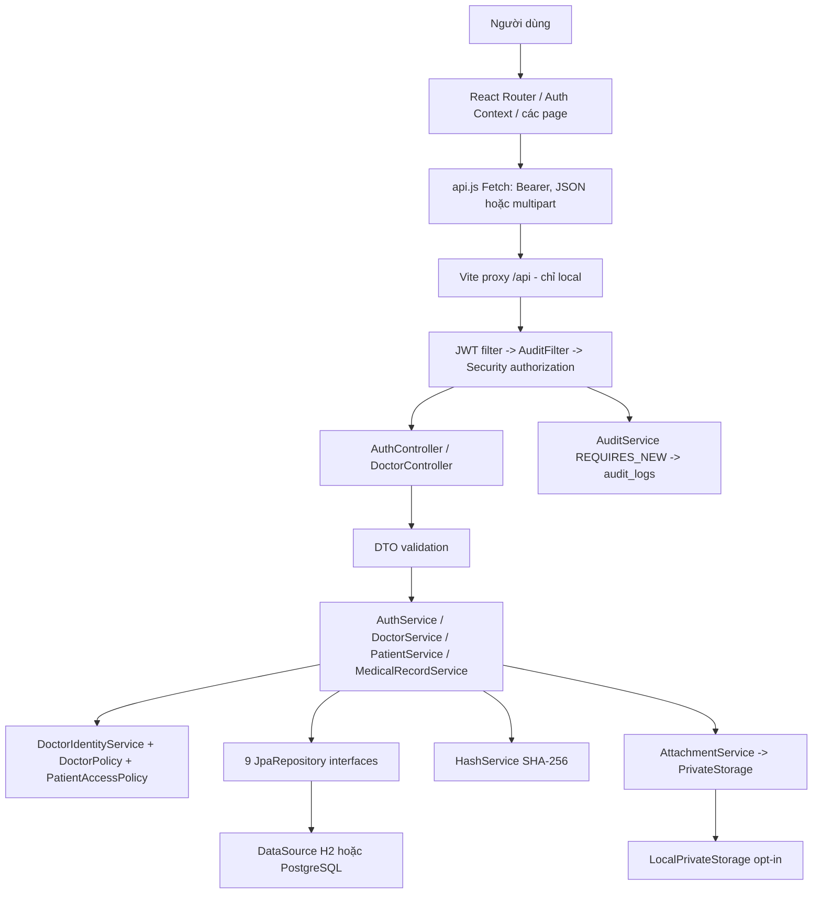

# 01 — Kiến trúc tổng thể và cách truy vết hệ thống

[← Mục lục](00_INDEX.md)

> Căn cứ: source đang có ngày 17/11/2026. Đây là phân tích tĩnh, không chạy API/test trong lượt viết tài liệu. Kết quả test ở handoff là bằng chứng lịch sử, không phải kiểm chứng Supabase hiện tại. SQL bên dưới chỉ minh họa tương đương logic, không phải log Hibernate.

## 1. Hệ thống đang có gì?

Doctor là hai ứng dụng: React/Vite ở Doctor/frontend và Spring Boot ở Doctor/demo.
React phát HTTP; nó không kết nối trực tiếp PostgreSQL và không có JWT secret.
Spring xử lý danh tính, consent, nghiệp vụ phiên bản, JPA và private storage.
Supabase là cấu hình PostgreSQL mặc định, H2 dùng local/test. Không suy ra schema production từ Entity đã compile.

[pom.xml](../../pom.xml#L1) xác nhận Java17, Spring Boot4.1.2, Spring Data JPA, Security, Validation,
WebMVC, PostgreSQL, JJWT0.12.6 và H2. H2 hiện có runtime scope để profile local dùng được.
[DemoApplication.java](../../src/main/java/com/blockchaincb/demo/DemoApplication.java#L6) là entry main và quét package con;
nó loại auto-config UserDetailsService mặc định vì xác thực JWT/account được triển khai riêng.

## 2. Sơ đồ kiến trúc thực tế



DTO validation nằm trong quá trình bind request MVC trước khi method Controller thực thi;
sơ đồ nhấn mạnh nó là cửa vào service, không phải lời gọi Java tường minh của Controller.
GlobalExceptionHandler xử lý exception MVC/service; SecurityErrors xử lý JSON từ filter/chain.

## 3. Vì sao chia lớp?

| Lớp | Trách nhiệm thật | Không nên hiểu nhầm |
|---|---|---|
| React | Form/state/route/loading/error, gọi API | Ẩn nút không tạo quyền |
| Controller | Bind request, validation, principal, status/DTO | Không tự insert SQL |
| Request DTO | Hình dạng và ràng buộc input | Không phải Entity JPA |
| Service | Quy tắc, transaction và điều phối | Không tự deploy contract |
| Repository | Truy vấn JPA/JPQL, paging/locking | Không quyết định mọi consent một mình |
| Entity | Mapping bảng/cột và state được Hibernate quản lý | Setter không tự commit |
| Policy | Rule account/approval/grant | Token không chứa grant vĩnh viễn |
| Storage adapter | Lưu/đọc bytes bằng key | Không phải public static URL |

Ví dụ mở [MedicalRecordService.java](../../src/main/java/com/blockchaincb/demo/service/MedicalRecordService.java#L58).
Controller chuyển DoctorPrincipal và MedicalRecordRequest vào đây. Service gọi identities.approved và
interface access.require trước khi save root; sau đó append tạo snapshot/hash và save version.
Repository không tự kiểm tra ai đang đăng nhập, vì vậy không gọi repository trực tiếp từ React/Controller
để bỏ qua service nghiệp vụ.

## 4. Constructor Dependency Injection

[DoctorService.java](../../src/main/java/com/blockchaincb/demo/service/DoctorService.java#L12) — trích nguyên văn:

```java
  public DoctorService(DoctorIdentityService identities) {
    this.identities = identities;
  }
```


Spring tạo DoctorIdentityService rồi truyền vào constructor. Field final giữ dependency ổn định.
DoctorService không tự new repository, không biết connection pool cụ thể.
Trong unit test, AuthService có thể được tạo bằng constructor với mock UserRepository/DoctorRepository/
SpecialtyRepository/PasswordEncoder. Đây là cách tách logic khỏi database.

Hai interface mở rộng thực tế:

- [PatientAccessPolicy.java](../../src/main/java/com/blockchaincb/demo/service/PatientAccessPolicy.java#L1): require(doctorId,patientId,Action).
  [DatabasePatientAccessPolicy.java](../../src/main/java/com/blockchaincb/demo/service/DatabasePatientAccessPolicy.java#L1) là implementation @Service hiện tại.
- [PrivateStorage.java](../../src/main/java/com/blockchaincb/demo/storage/PrivateStorage.java#L1): put/read bytes.
  [LocalPrivateStorage.java](../../src/main/java/com/blockchaincb/demo/storage/LocalPrivateStorage.java#L1) là implementation @Component.

Chưa có BlockchainService hoặc adapter on-chain. Khi thêm nhiều implementation cùng interface sau này
phải chọn bean bằng profile/qualifier hoặc cấu hình rõ, tránh inject mơ hồ.

## 5. Ba loại ID phải tách

| ID | Nguồn | Dùng ở đâu |
|---|---|---|
| User ID | public.users.id | JWT subject, actorUserId trong audit |
| Doctor ID | public.doctors.id | principal.doctorId, creator/author/grant |
| Patient ID trong module | doctor_backend.patient_links.id | Route patient, grant, record |
| Record ID | medical_records.id | Route và chuỗi phiên bản |
| Version ID / versionNumber | record_versions.id / số thứ tự trong record | previousVersionId / URL number |

Không dùng ID từ form làm Doctor identity. patient_links.id không mặc định bằng public.patients.id của nhóm.
Hai số version khác nữa là currentVersion nghiệp vụ và lockVersion của @Version; đọc flow10 để tránh nhầm.

## 6. Transaction và chiều trả về

Service public được Spring proxy bao transaction khi gọi từ bean khác.
Repository thao tác trong transaction hiện có; flush phát SQL, commit chốt transaction.
response(r,v) tạo DTO bên trong transaction, nên có thể đọc attachmentIds lazy trước khi đóng persistence context.
Một response thành công từ method target chưa bảo đảm proxy commit thành công; lỗi commit vẫn có thể xảy ra.
Audit record dùng REQUIRES_NEW riêng, không rollback cùng dữ liệu bệnh án.
Filesystem cũng không rollback theo DB.

## 7. Môi trường và bằng chứng kiểm thử

[application.properties](../../src/main/resources/application.properties#L1) dùng ddl-auto=validate,
sql.init.mode=never, open-in-view=false; password/secret qua biến môi trường, không chép giá trị vào tài liệu.
[application-local.properties](../../src/main/resources/application-local.properties#L1) dùng H2 memory và SQL local.
[DemoApplicationTests.java](../../src/test/java/com/blockchaincb/demo/DemoApplicationTests.java#L32)
cấp DataSource H2 riêng; [FrontendDemoApplication.java](../../src/test/java/com/blockchaincb/demo/FrontendDemoApplication.java#L1)
là launcher test riêng, không vào production JAR.

Handoff ghi nhận lịch sử 39 Java test, 8 frontend test và24 HTTP check. Bộ tài liệu này không chạy lại chúng.
Có test không đồng nghĩa mọi nhánh được cover; đặc biệt nhánh upload UPDATE-only cần test mới (flow12).
Không có bằng chứng mới về schema Supabase thực trong lượt này.

## 8. Cách đọc một request

1. Tìm route UI và handler trong [App.jsx](../../../frontend/src/App.jsx#L1).
2. Mở wrapper đúng tên trong [api.js](../../../frontend/src/api.js#L1), ghép tiền tố /api.
3. Đi qua [SecurityConfig.java](../../src/main/java/com/blockchaincb/demo/config/SecurityConfig.java#L1) và JwtAuthenticationFilter.
4. Tìm Controller mapping + request DTO.
5. Truy service public, helpers và transaction.
6. Đọc repository query, Entity và SQL đề xuất.
7. Theo response DTO về setState/navigate; truy error handler cho từng exception.
8. Đối chiếu test tên cụ thể, phân biệt hành vi đã test với suy luận tĩnh.

## 9. Những kiến thức nên giữ trong đầu

Constructor/interface/Optional/lambda/Stream xuất hiện ở các file thật, không cần học một lúc toàn bộ Java.
Mỗi flow bên dưới có code trích thực, câu hỏi và rủi ro. Đọc đăng ký trước rồi mới tới token,
phân quyền, quyền bệnh nhân và phiên bản. Không bắt đầu bằng getter/setter của toàn bộ Entity.
