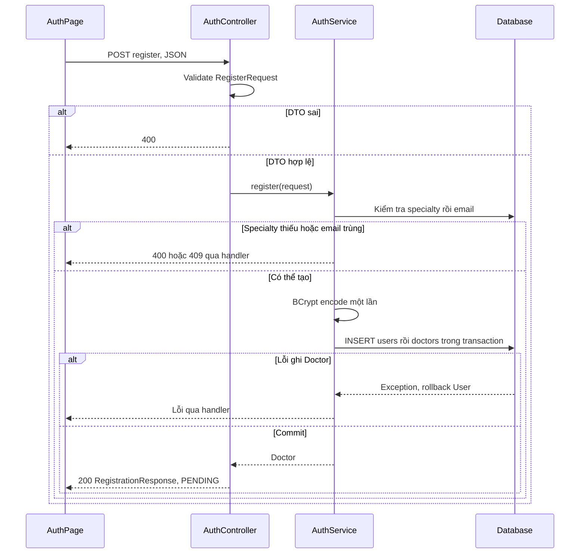

# 02 — Đăng ký Doctor

[← Mục lục](00_INDEX.md)

> Căn cứ: source đang có ngày 17/11/2026. Đây là phân tích tĩnh, không chạy API/test trong lượt viết tài liệu. Kết quả test ở handoff là bằng chứng lịch sử, không phải kiểm chứng Supabase hiện tại. SQL bên dưới chỉ minh họa tương đương logic, không phải log Hibernate.

## A. Chức năng này dùng để làm gì?

Người chưa có tài khoản mở /register. Kết quả mong muốn là một User có role DOCTOR và một Doctor liên kết User, cùng trạng thái ban đầu PENDING. Đây là tạo tài khoản chờ duyệt, chưa phải quyền khám bệnh. Endpoint đăng ký được permitAll cho POST; không yêu cầu JWT.

## B. Các file tham gia vào flow

Thứ tự là đường đi logic của request; filter chạy trước Controller. Các hàm phụ và chiều trả response có thể quay lại file đã đi qua.

| Thứ tự | File | Class/Method | Nhiệm vụ |
|---|---|---|---|
| 1 | [App.jsx](../../../frontend/src/App.jsx#L46) | `AuthPage.submit` | Nhận form đăng ký, state busy/error/success |
| 2 | [api.js](../../../frontend/src/api.js#L22) | `api.register → request` | POST JSON |
| 3 | [SecurityConfig.java](../../src/main/java/com/blockchaincb/demo/config/SecurityConfig.java#L29) | `securityFilterChain` | Cho phép đúng endpoint auth |
| 4 | [AuthController.java](../../src/main/java/com/blockchaincb/demo/controller/AuthController.java#L38) | `AuthController.register` | @Valid rồi gọi service |
| 5 | [RegisterRequest.java](../../src/main/java/com/blockchaincb/demo/dto/RegisterRequest.java#L8) | `RegisterRequest` | Ràng buộc email, mật khẩu, chuyên khoa |
| 6 | [AuthService.java](../../src/main/java/com/blockchaincb/demo/service/AuthService.java#L34) | `AuthService.register` | Transaction tạo hai Entity |
| 7 | [SpecialtyRepository.java](../../src/main/java/com/blockchaincb/demo/repository/SpecialtyRepository.java#L8) | `existsById (kế thừa)` | Kiểm tra chuyên khoa |
| 8 | [PasswordConfig.java](../../src/main/java/com/blockchaincb/demo/config/PasswordConfig.java#L13) | `passwordEncoder` | Cấp BCryptPasswordEncoder |
| 9 | [UserRepository.java](../../src/main/java/com/blockchaincb/demo/repository/UserRepository.java#L13) | `existsByEmail; save (kế thừa)` | Kiểm tra và lưu User |
| 10 | [DoctorRepository.java](../../src/main/java/com/blockchaincb/demo/repository/DoctorRepository.java#L7) | `save (kế thừa)` | Lưu Doctor |
| 11 | [User.java](../../src/main/java/com/blockchaincb/demo/entity/User.java#L8) | `User` | public.users |
| 12 | [Doctor.java](../../src/main/java/com/blockchaincb/demo/entity/Doctor.java#L13) | `Doctor.user` | doctors.user_id |
| 13 | [GlobalExceptionHandler.java](../../src/main/java/com/blockchaincb/demo/exception/GlobalExceptionHandler.java#L20) | `api; validation; conflict` | Trả lỗi an toàn |

## C. Sơ đồ luồng hoạt động



## D. Giải thích toàn bộ flow từng bước

### Bước 1: Form React và chuyển dữ liệu

AuthPage dùng cùng component cho login/register qua prop register. Các input đăng ký là uncontrolled: giá trị nằm ở DOM; busy/error/success là React state. submit(e) chặn submit mặc định bằng preventDefault, chụp form trước await, chuyển FormData thành object. specialtyId được Number() để JSON chứa số. TextEncoder kiểm tra mật khẩu không quá 72 byte UTF-8, vì ký tự tiếng Việt có thể chiếm nhiều byte.

### Bước 2: Fetch và Security

api.register gọi request("/auth/doctor/register", {method:"POST",body}). request thêm tiền tố /api và Content-Type application/json khi body không phải FormData. Vite proxy /api tới Backend local. SecurityConfig cho POST /api/auth/doctor/register đi qua; JwtAuthenticationFilter bỏ qua đường auth nên không có principal Doctor hay audit HTTP đã xác thực cho đăng ký.

### Bước 3: DTO đến Controller

@RestController giúp Spring serialize đối tượng response thành JSON. @RequestMapping trên class ghép với @PostMapping thành URL cuối. @RequestBody giải mã JSON thành RegisterRequest; @Valid kích hoạt @NotBlank, @Email, @Size, @NotNull và @Positive. Controller chưa chạy register service nếu validation thất bại. Trường role/approval không thuộc DTO; service tự đặt thay vì tin client.

### Bước 4: Thứ tự thật trong register

Constructor nhận bốn dependency qua Spring DI: repository Doctor, User, PasswordEncoder và SpecialtyRepository. Mở method sẽ thấy specialtyRepository.existsById chạy trước, kế đó kiểm tra số byte mật khẩu, rồi userRepository.existsByEmail. Thứ tự này khác ví dụ diễn giải kiểm tra email đầu tiên trong một số bối cảnh cũ. Specialty thiếu trả ApiException 400; email trùng 409.

### Bước 5: Băm rồi lưu User

passwordEncoder.encode tạo BCrypt hash có salt. Không dùng SHA-256 bệnh án để thay cho password hashing. Hash được gán users.password_hash; role được hardcode DOCTOR, enabled=true. userRepository.save trả User đã có identity id cần cho liên kết. SQL minh họa: INSERT INTO public.users(email,password_hash,full_name,role,enabled) VALUES (...). Chú thích “Luu User vao Supabase” trong code không quyết định môi trường; DataSource hiện hoạt động mới quyết định H2 hay PostgreSQL.

### Bước 6: Lưu Doctor và tính nguyên tử

doctor.setUser(user) gắn object User; JPA ghi user_id từ User.id qua @ManyToOne/@JoinColumn. Doctor có specialtyId kiểu Long; FK specialties được khai báo trong SQL local/đề xuất. licenseNumber và licenseNo đều nhận chứng chỉ; tên/email/hash bị lưu lặp để tương thích schema cũ. status và approvalStatus đều PENDING. @Transactional trên register bao cả hai save; lỗi runtime khi ghi Doctor làm rollback User. Save/flush không đồng nghĩa commit; commit xảy ra ở biên proxy transaction trước khi Controller nhận kết quả thành công.

### Bước 7: Response và giao diện

Service trả Doctor nội bộ; Controller không serialize Entity mà tạo RegistrationResponse(message,id,email,status,approvalStatus), HTTP 200 do không khai báo @ResponseStatus ở method này. React không nhận token; nó hiện success và reset form. Người dùng bấm Đăng nhập để đi tiếp. api.js dịch lỗi theo HTTP status, không hiển thị nguyên văn mọi message từ Backend.

### Request/response minh họa theo contract source

POST /api/auth/doctor/register — payload dưới đây là ví dụ, không phải lệnh đã chạy:
```json
{"fullName":"Bác sĩ minh họa","email":"doctor@example.test","password":"<MAT_KHAU_NHAP>","licenseNumber":"DEMO-001","hospital":"Cơ sở minh họa","specialtyId":2}
```
Response minh họa: message="Dang ky thanh cong", id=10, email như request, status=PENDING, approvalStatus=PENDING. ID phụ thuộc database.

## E. Giải thích code quan trọng

[AuthService.java](../../src/main/java/com/blockchaincb/demo/service/AuthService.java#L36) — trích nguyên văn:

```java
    if (!specialtyRepository.existsById(request.getSpecialtyId())) {
      throw new com.blockchaincb.demo.exception.ApiException(400, "Chuyen khoa khong ton tai");
    }
    if (request.getPassword().getBytes(java.nio.charset.StandardCharsets.UTF_8).length > 72) {
      throw new com.blockchaincb.demo.exception.ApiException(
          400, "Mat khau vuot qua 72 byte UTF-8");
    }
    // 1. Kiem tra email trong bang users
    if (userRepository.existsByEmail(request.getEmail())) {
      throw new com.blockchaincb.demo.exception.ApiException(409, "Email da ton tai");
    }

```

if đầu chặn ID chuyên khoa không tồn tại trước khi insert. existsById là method có sẵn của JpaRepository. Không chỉ @Positive là đủ: 999 vẫn dương nhưng có thể không tồn tại. Bỏ check này sẽ đẩy lỗi xuống FK và mất thông báo nghiệp vụ 400.

[AuthService.java](../../src/main/java/com/blockchaincb/demo/service/AuthService.java#L61) — trích nguyên văn:

```java
    user = userRepository.save(user);

    // 5. Tao ho so Doctor
    Doctor doctor = new Doctor();

    doctor.setUser(user);
    doctor.setSpecialtyId(request.getSpecialtyId());
    doctor.setFullName(request.getFullName());
    doctor.setEmail(request.getEmail());
    doctor.setLicenseNumber(request.getLicenseNumber());
    doctor.setLicenseNo(request.getLicenseNumber());
    doctor.setHospital(request.getHospital());
```

Phải dùng User vừa được lưu làm liên kết Doctor. Nếu bỏ setUser, cột user_id NOT NULL không có giá trị. Constructor DI làm dependencies rõ ràng và cho phép unit test truyền mock thay repository thật.

[AuthService.java](../../src/main/java/com/blockchaincb/demo/service/AuthService.java#L75) — trích nguyên văn:

```java
    doctor.setPassword(hashedPassword);

    // 6. Trang thai cho Admin duyet
    doctor.setStatus("PENDING");
    doctor.setApprovalStatus("PENDING");

    // 7. Luu Doctor
    return doctorRepository.save(doctor);
  }
```

Chỉ một hash được tạo và sao vào cột legacy; không lưu raw password. Hai PENDING là giá trị server quyết định. Không được xem enabled=true là đã được Admin phê duyệt.

## F. Các trường hợp thành công và thất bại

| Trường hợp | Điều kiện | Kết quả | Code xử lý |
|---|---|---|---|
| Thành công | DTO và specialty hợp lệ, email mới | 200, hai hàng liên kết | register |
| Dữ liệu sai | Email sai; specialty null/âm; mật khẩu ngắn | 400 | @Valid → validation |
| Chuyên khoa thiếu | ID dương nhưng không tồn tại | 400 | AuthService.register |
| Email trùng | existsByEmail true hoặc UNIQUE DB | 409 | ApiException/conflict |
| Ghi Doctor lỗi | Vi phạm DB constraint | Rollback; thường 409 nếu DataIntegrityViolation | @Transactional; conflict |

### Lưu ý hoặc rủi ro

existsByEmail chỉ là kiểm tra trước: hai request đồng thời vẫn cần UNIQUE thật trong DB để ngăn duplicate. Không chuẩn hóa chữ hoa/thường email. Schema Supabase chung chưa được xác minh trong lượt này. Mật khẩu hash legacy vẫn lưu lặp; không tự đổi schema trong tài liệu.

### Đọc test để kiểm tra lại lập luận

[DemoApplicationTests.java](../../src/test/java/com/blockchaincb/demo/DemoApplicationTests.java#L192) kiểm tra rollback; cùng file có registrationPersistsSameBcryptHashAndDuplicateIsConflict và rejectsInvalidSpecialtyAndValidationWithoutWrites.

## G. Bài học rút ra

Nhớ phân biệt DTO đầu vào, Entity được quản lý và response record. Annotation chính: @Valid, @NotBlank, @Email, @Positive, @Service, @Transactional, @ManyToOne. Đọc lại register và AuthPage.submit; không nhầm BCrypt với mã hóa có thể giải mã, và không nhầm enabled với approval.

### Câu hỏi tự kiểm tra

1. Vì sao lưu User trước Doctor?
2. Nếu save Doctor ném lỗi thì User đã commit chưa?
3. Tại sao chỉ @Positive không kiểm tra được specialty tồn tại?
4. Phản hồi đăng ký có JWT không, React làm gì tiếp?
