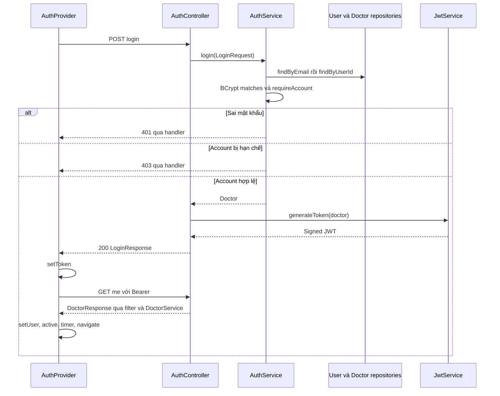

# 03 — Đăng nhập và quản lý phiên JWT

[← Mục lục](00_INDEX.md)

> Căn cứ: source đang có ngày 17/11/2026. Đây là phân tích tĩnh, không chạy API/test trong lượt viết tài liệu. Kết quả test ở handoff là bằng chứng lịch sử, không phải kiểm chứng Supabase hiện tại. SQL bên dưới chỉ minh họa tương đương logic, không phải log Hibernate.

## A. Chức năng này dùng để làm gì?

Doctor nhập email/password để lấy token. PENDING và REJECTED vẫn có thể đăng nhập xem trạng thái; BLOCKED, disabled hoặc sai role bị chặn. JWT là vé xác thực cho request sau, không phải chứng nhận quyền bệnh nhân.

## B. Các file tham gia vào flow

Thứ tự là đường đi logic của request; filter chạy trước Controller. Các hàm phụ và chiều trả response có thể quay lại file đã đi qua.

| Thứ tự | File | Class/Method | Nhiệm vụ |
|---|---|---|---|
| 1 | [App.jsx](../../../frontend/src/App.jsx#L12) | `AuthProvider.login; AuthPage.submit` | Quản lý session và điều hướng |
| 2 | [api.js](../../../frontend/src/api.js#L21) | `api.login; request` | POST login |
| 3 | [AuthController.java](../../src/main/java/com/blockchaincb/demo/controller/AuthController.java#L45) | `AuthController.login` | Validate và tạo response |
| 4 | [LoginRequest.java](../../src/main/java/com/blockchaincb/demo/dto/LoginRequest.java#L6) | `LoginRequest` | Email/password bắt buộc |
| 5 | [AuthService.java](../../src/main/java/com/blockchaincb/demo/service/AuthService.java#L86) | `AuthService.login` | Tìm User và so mật khẩu |
| 6 | [UserRepository.java](../../src/main/java/com/blockchaincb/demo/repository/UserRepository.java#L11) | `findByEmail` | Đọc tài khoản chung |
| 7 | [DoctorRepository.java](../../src/main/java/com/blockchaincb/demo/repository/DoctorRepository.java#L11) | `findByUserId` | Nạp Doctor và User |
| 8 | [DoctorPolicy.java](../../src/main/java/com/blockchaincb/demo/security/DoctorPolicy.java#L10) | `requireAccount` | Role, enabled, trạng thái |
| 9 | [JwtService.java](../../src/main/java/com/blockchaincb/demo/security/JwtService.java#L25) | `generateToken` | Ký JWT |
| 10 | [api.js](../../../frontend/src/api.js#L3) | `setToken; api.me` | Lưu token trong bộ nhớ, xác nhận hồ sơ |

## C. Sơ đồ luồng hoạt động



## D. Giải thích toàn bộ flow từng bước

### Bước 1: React submit và state

AuthPage.submit nhánh không-register gọi login(values) từ context. Email/password lấy bằng FormData; busy ngăn bấm gửi lặp trong lúc chờ. AuthProvider.login mới là nơi quản lý phiên: nó không dùng fullName/status trong LoginResponse làm hồ sơ cuối cùng mà gọi tiếp api.me sau khi setToken.

### Bước 2: Request và validation

api.login POST /api/auth/doctor/login. LoginRequest chỉ có email và password; email có @NotBlank/@Email/@Size(max=255), password có @NotBlank. Không có ràng buộc tối thiểu tám ký tự trên DTO login; đó là ràng buộc đăng ký. Service từ chối mật khẩu vượt 72 byte UTF-8 bằng 401 trước khi gọi encoder.

### Bước 3: Tìm User và BCrypt

@Transactional(readOnly=true) giữ quá trình đọc cùng transaction. userRepository.findByEmail trả Optional<User>. orElseThrow dùng lambda trì hoãn tạo ApiException 401 cho trường hợp không tìm thấy. passwordEncoder.matches(raw,user.getPasswordHash()) so mật khẩu với BCrypt hash trong users. Không encode lại rồi so string: salt làm mỗi lần encode cho hash khác nhau.

### Bước 4: Tìm hồ sơ và policy theo thứ tự thật

Sau khi mật khẩu đúng, doctorRepository.findByUserId(user.id) mới chạy, dùng @EntityGraph(attributePaths="user") để nạp User cần thiết. Thiếu Doctor trả 403. Sau đó DoctorPolicy.requireAccount kiểm tra DOCTOR, enabled, BLOCKED và trạng thái approval hợp lệ. Vì vậy source kiểm tra role/enabled sau khi tìm Doctor; không đảo lại thứ tự khi truy vết. PENDING/REJECTED được policy account chấp nhận, requireApproved chưa chạy ở login.

### Bước 5: Ký JWT

Controller nhận Doctor đã kiểm tra rồi gọi JwtService.generateToken. subject là users.id dạng string, không phải email. Claim doctorId phục vụ metadata, không được filter tin để cấp quyền. iss=blockchaincb-doctor, aud chứa doctor-api, iat là now, exp=now+1 giờ. Khóa được lấy từ biến jwt.secret, Base64 decode thành HMAC SecretKey. signWith(secretKey) ký JWT; không phải mã hóa nội dung claims.

### Bước 6: Response và kiểm tra phiên thật

LoginResponse trả message,token,tokenType=Bearer,id Doctor,fullName,email,status,approvalStatus. HTTP 200. AuthProvider lưu token qua setToken trong module api.js rồi GET /api/doctor/me bằng token mới. /me thất bại khiến logout và ném lỗi; chỉ sau /me thành công user/active mới được đặt và AuthPage.navigate("/") chạy.

### Bước 7: Hết hạn và logout

AuthProvider đọc exp để đặt timer phục vụ UX; việc đọc Base64 phía React không xác minh chữ ký. Backend vẫn là nguồn xác thực. useRef giữ timer qua các render. Logout clearTimeout, xóa token/user/active, ghi notice. api.request gặp 401 với token sẽ xóa token và phát doctor:expired. Không có refresh-token endpoint; reload trang làm mất token. /me tự refresh khi focus hoặc mỗi 30 giây nếu active.

### Request/response minh họa theo contract source

Ví dụ contract: POST /api/auth/doctor/login nhận {"email":"doctor@example.test","password":"<MAT_KHAU_NHAP>"}. Response gồm token="<JWT>", tokenType="Bearer", id=10 và approvalStatus="PENDING". Các giá trị ID/trạng thái chỉ minh họa.

## E. Giải thích code quan trọng

[AuthService.java](../../src/main/java/com/blockchaincb/demo/service/AuthService.java#L96) — trích nguyên văn:

```java
    if (!passwordEncoder.matches(request.getPassword(), user.getPasswordHash())) {
      throw new com.blockchaincb.demo.exception.ApiException(401, "Email hoac mat khau khong dung");
    }
    Doctor doctor =
        doctorRepository
```

matches dùng raw password và hash chuẩn từ User. Bỏ đoạn này sẽ cho người chỉ biết email đi tiếp; không thay bằng Doctor.password.

[JwtService.java](../../src/main/java/com/blockchaincb/demo/security/JwtService.java#L29) — trích nguyên văn:

```java
    return Jwts.builder()
        .subject(doctor.getUser().getId().toString())
        .issuer("blockchaincb-doctor")
        .audience()
        .add("doctor-api")
        .and()
        .claim("doctorId", doctor.getId())
        .issuedAt(now)
        .expiration(expiration)
        .signWith(secretKey)
        .compact();
  }

  // lay thong tin tu jwt
  public Claims extractClaims(String token) {
```

Builder lần lượt đặt danh tính, issuer, audience, metadata, thời gian và chữ ký. Thiếu signWith thì không còn bằng chứng chữ ký server như cơ chế đang dùng. Thời hạn một giờ không có nghĩa quyền vẫn giữ nguyên trong một giờ: DB được kiểm tra lại.

[App.jsx](../../../frontend/src/App.jsx#L12) — trích nguyên văn:

```jsx
  async function login(body) {
    const result = await api.login(body); setToken(result.token);
    try { const me = await api.me(); setUser(me); setActive(true); setNotice('');
      let ms = 3600000; try { ms = JSON.parse(atob(result.token.split('.')[1].replace(/-/g,'+').replace(/_/g,'/'))).exp * 1000 - Date.now(); } catch { /* API remains authoritative */ }
      clearTimeout(expiry.current); expiry.current = setTimeout(() => logout('Phiên đăng nhập đã hết hạn.'), Math.max(0, ms));
```

setToken diễn ra trước api.me để request me có Authorization. setUser chỉ sau me thành công giúp UI không mở nghiệp vụ bằng response login chưa được xác minh qua request bảo vệ.

## F. Các trường hợp thành công và thất bại

| Trường hợp | Điều kiện | Kết quả | Code xử lý |
|---|---|---|---|
| Đúng mật khẩu | User/Doctor hợp lệ | 200 và JWT | login; generateToken |
| Sai email/password | Optional rỗng hoặc matches false | 401 | AuthService.login |
| Không phải Doctor | Thiếu Doctor hoặc role khác | 403 | findByUserId; requireAccount |
| Disabled/BLOCKED | enabled=false hoặc một cờ BLOCKED | 403 | requireAccount |
| PENDING/REJECTED | Account chưa blocked | Login 200, nghiệp vụ bệnh án vẫn 403 | requireAccount vs requireApproved |

### Lưu ý hoặc rủi ro

JWT không có cơ chế logout phía server theo phiên; logout hiện chỉ xóa token ở frontend. isTokenValid chỉ thử parse claims, còn filter dùng extractUserId; hai việc không tương đương hoàn toàn nếu subject không phải số. Không đưa token thật hay secret vào tài liệu.

### Đọc test để kiểm tra lại lập luận

[AuthServiceTest.java](../../src/test/java/com/blockchaincb/demo/AuthServiceTest.java#L51) và [JwtServiceTest.java](../../src/test/java/com/blockchaincb/demo/JwtServiceTest.java#L17)

## G. Bài học rút ra

Nhớ Optional không phải User: cần xử lý rỗng. Lambda trong orElseThrow chỉ tạo lỗi khi cần. Token ký khác token mã hóa. id trong response là Doctor ID, còn subject là User ID. Transaction readOnly không tạo một phiên đăng nhập HTTP session.

### Câu hỏi tự kiểm tra

1. Mật khẩu login lấy từ bảng nào?
2. Vai trò doctorId claim khác subject ra sao?
3. Vì sao React còn gọi /me sau login?
4. Vì sao PENDING nhận token nhưng vẫn không thể khám?
