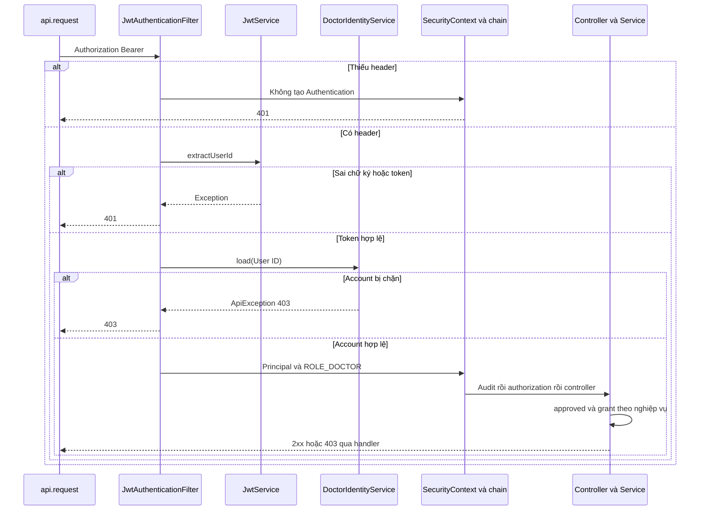

# 04 — Xác thực và phân quyền cho mỗi request

[← Mục lục](00_INDEX.md)

> Căn cứ: source đang có ngày 17/11/2026. Đây là phân tích tĩnh, không chạy API/test trong lượt viết tài liệu. Kết quả test ở handoff là bằng chứng lịch sử, không phải kiểm chứng Supabase hiện tại. SQL bên dưới chỉ minh họa tương đương logic, không phải log Hibernate.

## A. Chức năng này dùng để làm gì?

Authentication trả lời “đây là tài khoản nào?”, Authorization trả lời “tài khoản đó có được thực hiện hành động này không?”. Token hợp lệ mới là lớp đầu; role, enabled, approval và grant hiện hành là những lớp tiếp theo. Mỗi request bảo vệ phải tự xác thực vì cấu hình stateless.

## B. Các file tham gia vào flow

Thứ tự là đường đi logic của request; filter chạy trước Controller. Các hàm phụ và chiều trả response có thể quay lại file đã đi qua.

| Thứ tự | File | Class/Method | Nhiệm vụ |
|---|---|---|---|
| 1 | [api.js](../../../frontend/src/api.js#L5) | `request` | Gắn Bearer token |
| 2 | [SecurityConfig.java](../../src/main/java/com/blockchaincb/demo/config/SecurityConfig.java#L14) | `securityFilterChain` | Stateless, rule endpoint, handler 401/403 |
| 3 | [JwtAuthenticationFilter.java](../../src/main/java/com/blockchaincb/demo/security/JwtAuthenticationFilter.java#L24) | `shouldNotFilter; doFilterInternal` | Lọc đường Doctor và đọc Authorization |
| 4 | [JwtService.java](../../src/main/java/com/blockchaincb/demo/security/JwtService.java#L57) | `extractUserId; extractClaims` | Verify chữ ký, iss, aud, exp |
| 5 | [DoctorIdentityService.java](../../src/main/java/com/blockchaincb/demo/security/DoctorIdentityService.java#L18) | `load` | Tìm Doctor bằng User ID từ token |
| 6 | [DoctorRepository.java](../../src/main/java/com/blockchaincb/demo/repository/DoctorRepository.java#L12) | `findByUserId` | EntityGraph User |
| 7 | [DoctorPolicy.java](../../src/main/java/com/blockchaincb/demo/security/DoctorPolicy.java#L10) | `requireAccount; requireApproved` | Quy tắc tài khoản |
| 8 | [DoctorPrincipal.java](../../src/main/java/com/blockchaincb/demo/security/DoctorPrincipal.java#L3) | `DoctorPrincipal` | Cặp userId/doctorId đáng tin từ DB |
| 9 | [AuditFilter.java](../../src/main/java/com/blockchaincb/demo/security/AuditFilter.java#L19) | `doFilterInternal` | Audit sau xác thực |
| 10 | [DoctorController.java](../../src/main/java/com/blockchaincb/demo/controller/DoctorController.java#L41) | `Các method DoctorController` | Nhận principal do Security cung cấp |
| 11 | [DatabasePatientAccessPolicy.java](../../src/main/java/com/blockchaincb/demo/service/DatabasePatientAccessPolicy.java#L22) | `require` | Quyền từng bệnh nhân/hành động |

## C. Sơ đồ luồng hoạt động



## D. Giải thích toàn bộ flow từng bước

### Bước 1: Điều phối chain

SecurityConfig tắt csrf cho cách dùng Bearer hiện tại, sessionCreationPolicy STATELESS, tắt requestCache/formLogin/httpBasic/logout. Hai POST auth permitAll; /api/doctor/** cần hasRole("DOCTOR"); đường khác denyAll. hasRole dùng authority ROLE_DOCTOR, đúng string mà filter tạo. Không có cấu hình cookie authentication hay refresh token.

### Bước 2: Chọn request cần kiểm tra

shouldNotFilter tính request URI bỏ contextPath và chỉ chạy filter cho prefix /api/doctor/. Có header nhưng không bắt đầu bằng chuỗi "Bearer " đúng cách sẽ ném IllegalArgumentException, trả 401. Thiếu header thì không tự trả ngay; filter để request đi tiếp không Authentication, Security entry point xử lý 401.

### Bước 3: Parse JWT không chỉ decode

extractUserId gọi extractClaims: parser verifyWith(secretKey), requireIssuer, requireAudience, parseSignedClaims và kiểm tra expiration không null. Parser kiểm tra chữ ký/thời gian. Sau đó Long.valueOf(subject). Subject lỗi số bị catch IllegalArgumentException trong filter. Claims do client tự JSON/base64 hóa không đủ nếu không có chữ ký đúng.

### Bước 4: Danh tính từ DB

identities.load tìm Doctor theo User ID, nạp User qua EntityGraph, gọi requireAccount. Nếu tài khoản đã disable hoặc đổi role sau lúc cấp JWT, request tiếp theo bị từ chối. Filter tạo DoctorPrincipal từ d.user.id và d.id trong DB, không lấy doctorId từ query/body/claim để cấp quyền.

### Bước 5: SecurityContext và Controller

UsernamePasswordAuthenticationToken được tạo với principal, credential=null và một SimpleGrantedAuthority ROLE_DOCTOR. Gán vào SecurityContextHolder cho request hiện tại. @AuthenticationPrincipal trong Controller lấy lại đối tượng đó. Controller không cần parse token lần nữa. AuditFilter đặt sau JWT filter nhưng trước các bước còn lại của chain, ghi ATTEMPT rồi mới cho request đi tiếp.

### Bước 6: Quyền chức năng và dữ liệu

Role DOCTOR chưa đủ cho hồ sơ: service gọi identities.approved; method này load account lại, kiểm tra Doctor ID tương ứng, requireApproved. PatientAccessPolicy.require kiểm tra READ/CREATE/UPDATE cho chính Doctor ID đó. API /me chỉ gọi load, nên không cần approved. Các lớp kiểm tra có mục đích khác nhau, không phải logic thừa có thể bỏ tùy ý.

### Bước 7: Phản hồi lỗi phân biệt tầng

JWT filter bắt lỗi token tự viết JSON bằng SecurityErrors, không đi qua @RestControllerAdvice. Security entry point/denied handler cũng dùng SecurityErrors. Lỗi nghiệp vụ ApiException trong service đến GlobalExceptionHandler. React api.js dựa status để dịch thông báo: 401 xóa phiên, 403 không tự logout toàn cục; riêng refresh /me lỗi sẽ logout.


## E. Giải thích code quan trọng

[JwtAuthenticationFilter.java](../../src/main/java/com/blockchaincb/demo/security/JwtAuthenticationFilter.java#L38) — trích nguyên văn:

```java
            new UsernamePasswordAuthenticationToken(
                new DoctorPrincipal(d.getUser().getId(), d.getId()),
                null,
                List.of(new SimpleGrantedAuthority("ROLE_DOCTOR")));
        SecurityContextHolder.getContext().setAuthentication(auth);
      } catch (ApiException e) {
        SecurityContextHolder.clearContext();
```

Đây là lúc chuyển danh tính đã kiểm tra thành Authentication. Credential null tránh giữ raw password. Bỏ setAuthentication thì hasRole không thấy người dùng đăng nhập dù token parse đúng.

[DoctorIdentityService.java](../../src/main/java/com/blockchaincb/demo/security/DoctorIdentityService.java#L28) — trích nguyên văn:

```java
  public Doctor approved(DoctorPrincipal p) {
    Doctor d = load(p.userId());
    if (!d.getId().equals(p.doctorId())) throw new ApiException(403, "Danh tinh khong hop le");
    DoctorPolicy.requireApproved(d);
    return d;
  }
```

approved tải User/Doctor và so cặp ID, sau đó requireApproved. Nó được gọi ở service để ràng buộc nghiệp vụ, không dựa sidebar React.

[SecurityConfig.java](../../src/main/java/com/blockchaincb/demo/config/SecurityConfig.java#L21) — trích nguyên văn:

```java
        .sessionManagement(s -> s.sessionCreationPolicy(SessionCreationPolicy.STATELESS))
        .requestCache(c -> c.disable())
        .formLogin(c -> c.disable())
        .httpBasic(c -> c.disable())
        .logout(c -> c.disable())
        .authorizeHttpRequests(
```

STATELESS nghĩa không dựa HttpSession để nhận diện request sau. Nếu chỉ sinh JWT nhưng bỏ filter, việc đăng nhập không tự nạp SecurityContext cho các request mới.

## F. Các trường hợp thành công và thất bại

| Trường hợp | Điều kiện | Kết quả | Code xử lý |
|---|---|---|---|
| Được xác thực | Token và account hợp lệ | Đi tiếp chain | doFilterInternal |
| Không đăng nhập | Thiếu Authorization | 401 | authenticationEntryPoint |
| Token lỗi | Sai ký, hết hạn, sai iss/aud hoặc subject lỗi | 401 | JwtService + JWT filter |
| Account bị khóa | Policy account thất bại | 403 | DoctorIdentityService.load |
| Thiếu quyền nghiệp vụ | Chưa approved hoặc grant thiếu | 403 | Service + GlobalExceptionHandler |

### Lưu ý hoặc rủi ro

Lỗi DB xảy ra trong JWT filter không thuộc hai nhóm catch token/ApiException; @RestControllerAdvice không bảo đảm xử lý lỗi trước DispatcherServlet. Không suy diễn mọi lỗi đều thành JSON chuẩn. CSRF tắt phù hợp với mô hình hiện tại, không có nghĩa an toàn nếu sau này đổi sang cookie auth mà giữ nguyên cấu hình.

### Đọc test để kiểm tra lại lập luận

[DemoApplicationTests.java](../../src/test/java/com/blockchaincb/demo/DemoApplicationTests.java#L271)

## G. Bài học rút ra

Học interface SecurityFilterChain và filter trước Controller. Annotation @AuthenticationPrincipal khác @RequestParam: nguồn dữ liệu từ SecurityContext thay vì input client. Nhớ bắt exception ở filter khác exception MVC. Authentication hợp lệ có thể nhận authorization 403.

### Câu hỏi tự kiểm tra

1. Thiếu header được xử lý tại đâu?
2. Vì sao filter không tin doctorId claim?
3. ROLE_DOCTOR được gán khi nào?
4. PENDING đi qua filter rồi bị chặn ở đâu khi gọi bệnh án?
