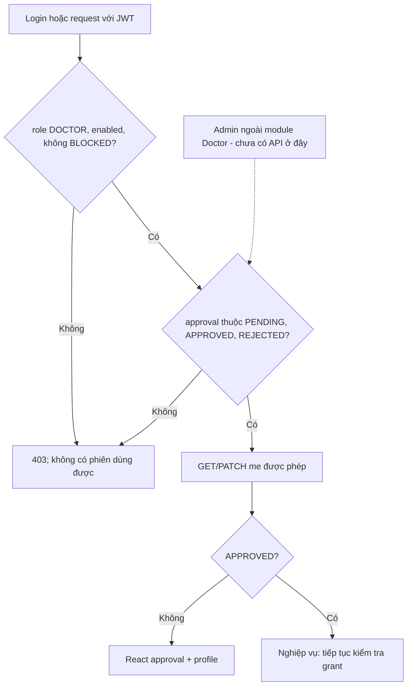

# 05 — Trạng thái phê duyệt và phạm vi module Doctor

[← Mục lục](00_INDEX.md)

> Căn cứ: source đang có ngày 17/11/2026. Đây là phân tích tĩnh, không chạy API/test trong lượt viết tài liệu. Kết quả test ở handoff là bằng chứng lịch sử, không phải kiểm chứng Supabase hiện tại. SQL bên dưới chỉ minh họa tương đương logic, không phải log Hibernate.

## A. Chức năng này dùng để làm gì?

Module Doctor thực thi trạng thái có trong DB và hiển thị trạng thái. Nó KHÔNG triển khai API Admin approve/reject. Người mới PENDING hoặc bị REJECTED vẫn có thể xem /me và sửa các thông tin cho phép; người bị BLOCKED/disabled không được sử dụng phiên qua API.

## B. Các file tham gia vào flow

Thứ tự là đường đi logic của request; filter chạy trước Controller. Các hàm phụ và chiều trả response có thể quay lại file đã đi qua.

| Thứ tự | File | Class/Method | Nhiệm vụ |
|---|---|---|---|
| 1 | [App.jsx](../../../frontend/src/App.jsx#L61) | `Shell; Approval; AuthProvider.refresh` | Route guard và kiểm tra trạng thái |
| 2 | [api.js](../../../frontend/src/api.js#L23) | `api.me` | GET hồ sơ hiện hành |
| 3 | [JwtAuthenticationFilter.java](../../src/main/java/com/blockchaincb/demo/security/JwtAuthenticationFilter.java#L36) | `doFilterInternal` | Kiểm tra account request |
| 4 | [DoctorController.java](../../src/main/java/com/blockchaincb/demo/controller/DoctorController.java#L41) | `DoctorController.me` | Endpoint trạng thái qua /me |
| 5 | [DoctorService.java](../../src/main/java/com/blockchaincb/demo/service/DoctorService.java#L17) | `DoctorService.me` | Chỉ load account, không approved |
| 6 | [DoctorIdentityService.java](../../src/main/java/com/blockchaincb/demo/security/DoctorIdentityService.java#L18) | `load; approved` | Tách policy account/nghiệp vụ |
| 7 | [DoctorPolicy.java](../../src/main/java/com/blockchaincb/demo/security/DoctorPolicy.java#L10) | `requireAccount; requireApproved` | Quy tắc trạng thái |
| 8 | [Doctor.java](../../src/main/java/com/blockchaincb/demo/entity/Doctor.java#L39) | `Doctor.approvalStatus; status` | Lưu giá trị trạng thái |
| 9 | [User.java](../../src/main/java/com/blockchaincb/demo/entity/User.java#L31) | `User.enabled; role` | Khóa tài khoản dùng chung |

## C. Sơ đồ luồng hoạt động



## D. Giải thích toàn bộ flow từng bước

### Bước 1: Nguồn ba nhóm cờ

User.enabled là boolean cho phép sử dụng tài khoản chung, không phải boolean đã phê duyệt. Doctor.approvalStatus ánh xạ approval_status là trạng thái nghiệp vụ. Doctor.status là cột legacy: code hiện chỉ dùng giá trị BLOCKED làm chặn bổ sung. Đăng ký đặt enabled=true và cả hai trạng thái PENDING.

### Bước 2: Những trạng thái policy chấp nhận

requireAccount từ chối role khác DOCTOR, disabled hoặc BLOCKED ở bất kỳ cột trạng thái nào. Sau đó nó chỉ chấp nhận tập PENDING/APPROVED/REJECTED; null hoặc giá trị lạ bị 403 theo fail-closed. requireApproved trước hết gọi requireAccount rồi đòi approvalStatus đúng APPROVED.

### Bước 3: Màn hình trạng thái

Shell kiểm tra user.approvalStatus từ Auth context. Chưa APPROVED thì không render ApprovedRoutes, chỉ profile/approval. Approval dùng Status để hiển thị nhãn và giải thích REJECTED khác PENDING. Nút Kiểm tra trạng thái gọi refresh -> api.me. Không có nút tự phê duyệt hay POST Admin trong React này.

### Bước 4: Luồng đọc và làm mới

GET /api/doctor/me chạy filter account, Controller.me, DoctorService.me, identities.load rồi DoctorResponse.from. User/Doctor được truy vấn để lấy trạng thái mới. AuthProvider còn tự gọi /me khi focus/mỗi 30 giây, cập nhật user khiến Shell render lại. APPROVED được chuyển về dashboard từ trang Approval bằng Navigate.

### Bước 5: Từ chối sau khi đã đăng nhập

Admin bên ngoài có thể thay đổi trạng thái DB theo quy trình nhóm. Trong module Doctor, request tiếp theo kiểm tra lại sẽ trả 403 nếu khóa; refresh /me catch lỗi dẫn tới logout, UI trở về login. Nếu chỉ bị đổi về PENDING, /me vẫn 200 nhưng Shell đóng các route nghiệp vụ. Không bảo đảm UI biết ngay tức thì tại thời điểm DB đổi.

### Bước 6: Ranh giới tích hợp

Không có AdminController hay method approve trong source. FrontendDemoApplication chỉ là launcher test: dùng JDBC UPDATE trạng thái trên H2 để dựng fixture, không phải API phê duyệt thật. approved_by/approved_at có trong SQL local theo bối cảnh nhưng Doctor Entity hiện chưa ánh xạ hai trường này. Luồng Admin phải do module nhóm cung cấp và thống nhất.


## E. Giải thích code quan trọng

[DoctorPolicy.java](../../src/main/java/com/blockchaincb/demo/security/DoctorPolicy.java#L10) — trích nguyên văn:

```java
  public static void requireAccount(Doctor d) {
    if (!"DOCTOR".equals(d.getUser().getRole())
        || !d.getUser().isEnabled()
        || "BLOCKED".equals(d.getStatus())
        || "BLOCKED".equals(d.getApprovalStatus()))
      throw new ApiException(403, "Tai khoan khong duoc phep truy cap");
    if (d.getApprovalStatus() == null
        || !Set.of("PENDING", "APPROVED", "REJECTED").contains(d.getApprovalStatus()))
      throw new ApiException(403, "Trang thai phe duyet khong hop le");
  }

  public static void requireApproved(Doctor d) {
    requireAccount(d);
    if (!"APPROVED".equals(d.getApprovalStatus()))
      throw new ApiException(403, "Bac si chua duoc phe duyet");
```

Hai nhóm kiểm tra nối bằng OR: chỉ cần một điều kiện khóa đúng là từ chối. Set.of kiểm soát allowlist trạng thái; nếu bỏ kiểm tra giá trị lạ, trạng thái chưa được thiết kế có thể bị dùng ngoài ý định.

[DoctorPolicy.java](../../src/main/java/com/blockchaincb/demo/security/DoctorPolicy.java#L21) — trích nguyên văn:

```java
  public static void requireApproved(Doctor d) {
    requireAccount(d);
    if (!"APPROVED".equals(d.getApprovalStatus()))
      throw new ApiException(403, "Bac si chua duoc phe duyet");
  }
}
```

requireApproved tái dùng requireAccount để không vô tình cho APPROVED nhưng disabled đi qua. Bỏ so APPROVED sẽ mở nghiệp vụ cho PENDING và REJECTED.

## F. Các trường hợp thành công và thất bại

| Trường hợp | Điều kiện | Kết quả | Code xử lý |
|---|---|---|---|
| Chờ duyệt | PENDING, enabled=true | /me 200, bệnh án 403 | requireAccount/requireApproved |
| Đã duyệt | APPROVED, enabled=true | Cần grant để thao tác bệnh án | approved + access.require |
| Từ chối | REJECTED | Xem trạng thái/profile, không khám | requireApproved |
| Khóa | BLOCKED hoặc enabled=false | 403 ở login/filter | requireAccount |
| Giá trị lạ | approvalStatus null/khác allowlist | 403 | requireAccount |

### Lưu ý hoặc rủi ro

Chưa có quy trình chuyển trạng thái, lý do reject hoặc audit phê duyệt của Admin trong module này. Không gọi fixture H2 là tính năng Admin production. Sidebar không thay thế kiểm soát từ service.

### Đọc test để kiểm tra lại lập luận

[DemoApplicationTests.java](../../src/test/java/com/blockchaincb/demo/DemoApplicationTests.java#L290)

## G. Bài học rút ra

Đừng gộp tất cả cờ thành một status ở frontend. Enum Action của quyền bệnh nhân không phải các trạng thái duyệt. Đọc DoctorPolicy trước khi đọc điều kiện JSX; Backend là nơi quyết định thực sự.

### Câu hỏi tự kiểm tra

1. APPROVED nhưng status=BLOCKED có được dùng không?
2. REJECTED có đăng nhập xem trạng thái được không?
3. Method nào đang phê duyệt Doctor thật?
4. Tại sao enabled=true không đủ quyền khám?
