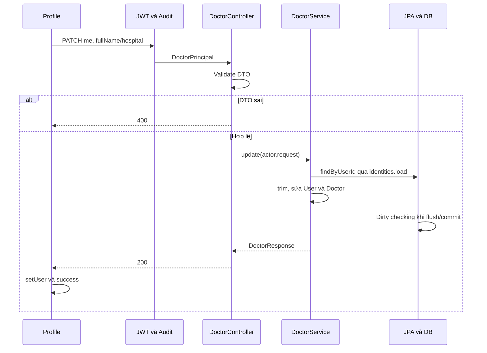

# 06 — Xem và cập nhật hồ sơ cá nhân

[← Mục lục](00_INDEX.md)

> Căn cứ: source đang có ngày 17/11/2026. Đây là phân tích tĩnh, không chạy API/test trong lượt viết tài liệu. Kết quả test ở handoff là bằng chứng lịch sử, không phải kiểm chứng Supabase hiện tại. SQL bên dưới chỉ minh họa tương đương logic, không phải log Hibernate.

## A. Chức năng này dùng để làm gì?

Doctor có account hợp lệ, kể cả PENDING/REJECTED, xem hồ sơ của chính mình và sửa tên/nơi công tác. Không có API sửa role, approval, chứng chỉ, email hay wallet ở đây. Kết quả là thông tin User/Doctor được cập nhật trong cùng transaction và context React nhận DoctorResponse mới.

## B. Các file tham gia vào flow

Thứ tự là đường đi logic của request; filter chạy trước Controller. Các hàm phụ và chiều trả response có thể quay lại file đã đi qua.

| Thứ tự | File | Class/Method | Nhiệm vụ |
|---|---|---|---|
| 1 | [App.jsx](../../../frontend/src/App.jsx#L75) | `Profile; AuthProvider` | Đọc user và submit form |
| 2 | [api.js](../../../frontend/src/api.js#L24) | `api.me; api.profile` | GET/PATCH me |
| 3 | [JwtAuthenticationFilter.java](../../src/main/java/com/blockchaincb/demo/security/JwtAuthenticationFilter.java#L36) | `doFilterInternal` | Nhận diện account hiện hành |
| 4 | [DoctorController.java](../../src/main/java/com/blockchaincb/demo/controller/DoctorController.java#L41) | `me; update` | Nhận principal và DTO |
| 5 | [ProfileUpdateRequest.java](../../src/main/java/com/blockchaincb/demo/dto/ProfileUpdateRequest.java#L5) | `ProfileUpdateRequest` | Chỉ fullName/hospital |
| 6 | [DoctorService.java](../../src/main/java/com/blockchaincb/demo/service/DoctorService.java#L22) | `me; update` | Transaction đọc/sửa managed entity |
| 7 | [DoctorIdentityService.java](../../src/main/java/com/blockchaincb/demo/security/DoctorIdentityService.java#L18) | `load` | User ID từ principal |
| 8 | [DoctorRepository.java](../../src/main/java/com/blockchaincb/demo/repository/DoctorRepository.java#L12) | `findByUserId` | Nạp Doctor và User |
| 9 | [DoctorResponse.java](../../src/main/java/com/blockchaincb/demo/dto/DoctorResponse.java#L16) | `from` | Ánh xạ response không password |

## C. Sơ đồ luồng hoạt động



## D. Giải thích toàn bộ flow từng bước

### Bước 1: GET và dữ liệu form

Sau login AuthProvider đã gọi /me và giữ user trong context. Profile hiển thị user này; component không tự gọi api.me mỗi lần mount. AuthProvider.refresh là đường làm mới hồ sơ. input fullName/hospital dùng defaultValue nên giá trị chỉnh sửa nằm ở DOM, không phải useState từng trường. error/success/busy mới là state của form.

### Bước 2: PATCH request

onSubmit preventDefault, đọc FormData, gửi api.profile(body) tức PATCH /api/doctor/me. Content-Type JSON và Bearer được request() thêm. Không có User ID trong URL: định danh lấy từ token/principal. Sau response setUser gọi cập nhật context và hiện success; lỗi đặt error.

### Bước 3: Controller và DTO

DoctorController.update có @AuthenticationPrincipal, @Valid @RequestBody ProfileUpdateRequest. Record DTO chỉ chứa fullName và hospital với @NotBlank/@Size(max=255); Controller chuyển actor và request vào DoctorService.update. GET me không cần DTO đầu vào. @Validated ở class hỗ trợ validation tham số khác trên các endpoint Doctor.

### Bước 4: Load trong transaction

DoctorService.update là @Transactional. identities.load(actor.userId()) gọi DoctorRepository.findByUserId có EntityGraph User, kiểm tra account. Khi tham gia transaction ngoài, Doctor và User là managed entities gắn cùng persistence context. Không gọi identities.approved nên PENDING/REJECTED vẫn có thể sửa các trường cho phép.

### Bước 5: Dirty checking thay vì save

Service trim fullName/hospital. Tên được gán vào cả d.user.fullName và d.fullName; hospital chỉ ở Doctor. Không thấy repository.save trong update: Hibernate theo dõi các thay đổi trên managed entity, tự phát UPDATE khi flush/commit. Nếu bỏ transaction và sửa entity đã detached, thay đổi có thể không được lưu. Không nên tưởng mọi setter tự ghi DB ngay.

### Bước 6: Response an toàn

DoctorResponse.from chọn id Doctor, userId, email và tên từ User, hospital/specialty/license/status/approval từ Doctor, wallet từ User. Không có passwordHash/password. Service tạo response trong transaction, sau đó commit thành công mới trả về Controller; HTTP 200. React không được tự gửi approvalStatus vào DTO để đổi quyền.

### Request/response minh họa theo contract source

PATCH /api/doctor/me với {"fullName":"Bác sĩ minh họa","hospital":"Cơ sở minh họa"}. Response DoctorResponse còn có email, specialtyId, approvalStatus và walletAddress; chúng không có nghĩa là PATCH cho phép sửa các trường đó.

## E. Giải thích code quan trọng

[DoctorService.java](../../src/main/java/com/blockchaincb/demo/service/DoctorService.java#L22) — trích nguyên văn:

```java
  public DoctorResponse update(DoctorPrincipal actor, ProfileUpdateRequest request) {
    var d = identities.load(actor.userId());
    d.getUser().setFullName(request.fullName().trim());
    d.setFullName(request.fullName().trim());
    d.setHospital(request.hospital().trim());
    return DoctorResponse.from(d);
  }
}
```

d là managed entity. Các setter cập nhật hai object liên quan, không tạo tài khoản mới. Bỏ setFullName ở User sẽ làm response vẫn lấy tên cũ vì DoctorResponse.from dùng d.getUser().getFullName().

[ProfileUpdateRequest.java](../../src/main/java/com/blockchaincb/demo/dto/ProfileUpdateRequest.java#L5) — trích nguyên văn:

```java
public record ProfileUpdateRequest(
    @NotBlank @Size(max = 255) String fullName, @NotBlank @Size(max = 255) String hospital) {}
```

Java record gom dữ liệu bất biến của request với accessor fullName()/hospital(). Giới hạn trường của DTO ngăn mass assignment vào role/approval ở service; validation là lớp đầu vào, còn service chỉ dùng hai accessor này.

## F. Các trường hợp thành công và thất bại

| Trường hợp | Điều kiện | Kết quả | Code xử lý |
|---|---|---|---|
| Xem/sửa | Account hợp lệ, payload đúng | 200 | DoctorService.me/update |
| Sai form | Tên trống hoặc quá dài | 400 | @Valid; validation |
| Khóa account | Disabled hoặc BLOCKED | 403 | JWT filter/policy |
| Thiếu token | Không có Authentication | 401 | Security chain |
| Lỗi DB | Constraint hoặc lỗi khác | 409 hoặc 500 tùy exception | GlobalExceptionHandler |

### Lưu ý hoặc rủi ro

defaultValue không tự đồng bộ input đang mở khi user context bị refresh từ nơi khác; cần phân biệt nhãn hiển thị và draft trong DOM. Dữ liệu tên/hash/email legacy chưa có cơ chế đồng bộ tổng quát giữa mọi module. Những điểm này là ghi nhận tĩnh, không sửa code.

### Đọc test để kiểm tra lại lập luận

[DemoApplicationTests.java](../../src/test/java/com/blockchaincb/demo/DemoApplicationTests.java#L232)

## G. Bài học rút ra

Nhớ constructor DI nối DoctorService với DoctorIdentityService. Managed entity + transaction tạo dirty checking; DTO không phải managed entity. Cần đọc lại DoctorResponse.from để biết chính xác nguồn của từng trường.

### Câu hỏi tự kiểm tra

1. Vì sao update không gọi save?
2. Tên lấy từ User hay Doctor khi trả response?
3. Có sửa wallet qua PATCH me được không?
4. Form input defaultValue khác state có onChange thế nào?
