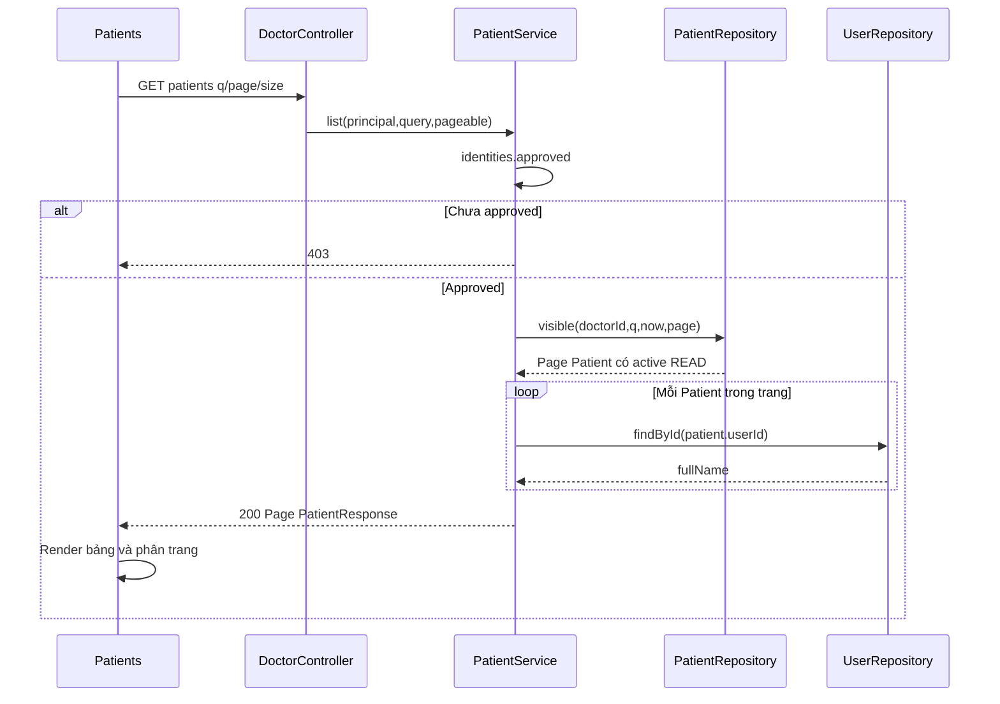

# 07 — Danh sách bệnh nhân và Patient Access Grant

[← Mục lục](00_INDEX.md)

> Căn cứ: source đang có ngày 17/11/2026. Đây là phân tích tĩnh, không chạy API/test trong lượt viết tài liệu. Kết quả test ở handoff là bằng chứng lịch sử, không phải kiểm chứng Supabase hiện tại. SQL bên dưới chỉ minh họa tương đương logic, không phải log Hibernate.

## A. Chức năng này dùng để làm gì?

Doctor APPROVED xem bệnh nhân có quyền READ còn hiệu lực cho chính mình, tìm theo tên và phân trang. API danh sách không cấp quyền và cũng không trả canCreate/canUpdate. Muốn tạo/cập nhật phải đi qua kiểm tra hành động riêng ở các service tương ứng.

## B. Các file tham gia vào flow

Thứ tự là đường đi logic của request; filter chạy trước Controller. Các hàm phụ và chiều trả response có thể quay lại file đã đi qua.

| Thứ tự | File | Class/Method | Nhiệm vụ |
|---|---|---|---|
| 1 | [App.jsx](../../../frontend/src/App.jsx#L72) | `Patients; PatientRecords` | query, page, bảng và link bệnh nhân |
| 2 | [api.js](../../../frontend/src/api.js#L25) | `api.patients` | GET query encoded |
| 3 | [JwtAuthenticationFilter.java](../../src/main/java/com/blockchaincb/demo/security/JwtAuthenticationFilter.java#L29) | `JWT filter và principal` | Danh tính từ DB |
| 4 | [DoctorController.java](../../src/main/java/com/blockchaincb/demo/controller/DoctorController.java#L52) | `patients` | Validate q/page/size |
| 5 | [PatientService.java](../../src/main/java/com/blockchaincb/demo/service/PatientService.java#L27) | `list` | approved và map DTO |
| 6 | [PatientRepository.java](../../src/main/java/com/blockchaincb/demo/repository/PatientRepository.java#L16) | `visible` | Query người được quyền READ |
| 7 | [UserRepository.java](../../src/main/java/com/blockchaincb/demo/repository/UserRepository.java#L11) | `findById (kế thừa)` | Lấy fullName |
| 8 | [Patient.java](../../src/main/java/com/blockchaincb/demo/entity/Patient.java#L7) | `Patient` | doctor_backend.patient_links |
| 9 | [AccessGrant.java](../../src/main/java/com/blockchaincb/demo/entity/AccessGrant.java#L8) | `AccessGrant` | Cờ hành động và hiệu lực |
| 10 | [DatabasePatientAccessPolicy.java](../../src/main/java/com/blockchaincb/demo/service/DatabasePatientAccessPolicy.java#L22) | `require` | Kiểm tra từng hành động ở API bệnh án |
| 11 | [AccessGrantRepository.java](../../src/main/java/com/blockchaincb/demo/repository/AccessGrantRepository.java#L12) | `activeLocked` | Query grant và khóa đọc |

## C. Sơ đồ luồng hoạt động



## D. Giải thích toàn bộ flow từng bước

### Bước 1: State tìm kiếm có hai mức

Patients giữ q là nội dung đang gõ; query là từ khóa đã submit. onChange chỉ setQ. Form submit mới setQuery(q), setPage(0); useLoad phụ thuộc query/page nên không gửi request ở mỗi phím gõ. Nút phân trang đổi page. Đây là state điều khiển truy vấn, không lưu toàn bộ bệnh nhân trong localStorage.

### Bước 2: API và tham số

api.patients dùng encodeURIComponent(q), page bắt đầu 0 và size=10. Controller default size=20 nếu client không gửi; @Min(0) cho page, @Min(1)/@Max(100) cho size, @Size(max=100) cho q. PageRequest.of chuyển thành Pageable. Frontend và Backend default khác nhau nhưng request thực tế gửi rõ size=10.

### Bước 3: Phê duyệt và query

PatientService.list @Transactional(readOnly=true) gọi identities.approved(actor), sau đó patients.visible(actor.doctorId(),query,Instant.now(),page). Doctor ID xuất phát từ principal, không có tham số doctorId để người dùng đổi. JPQL dùng entity Patient và User, không dùng tên bảng SQL trực tiếp.

### Bước 4: Điều kiện EXISTS

visible ghép p.userId=u.id, đòi u.role=PATIENT, lọc lower(fullName) LIKE lower(%q%). EXISTS grant g có g.patientId=p.id, doctorId đúng actor, canRead=true, revokedAt null, validFrom<=now và expiresAt null hoặc >now. order by p.id cho phân trang ổn định. EXISTS tránh lặp bệnh nhân khi có nhiều grant phù hợp.

### Bước 5: Map Page sang DTO

Page.map nhận lambda p -> new PatientResponse(...). Với mỗi Patient nó tìm User theo userId để lấy tên. Optional rỗng ném ApiException 409 “lien ket Patient” thay vì trả tên null. Response chỉ id cầu nối và fullName; Page còn có content,totalElements,totalPages. React render bảng, Empty nếu content rỗng, Pagination dựa totalPages.

### Bước 6: Quyền hành động khác READ

DatabasePatientAccessPolicy.require gọi activeLocked rồi Stream.anyMatch; switch Action chọn canRead/canCreate/canUpdate. canRead không tự suy ra hai quyền ghi. create cần READ+CREATE; update cần UPDATE+READ; upload cố thử CREATE rồi UPDATE. activeLocked có @Lock(PESSIMISTIC_READ), chỉ dùng trong thao tác nghiệp vụ có transaction; visible là query danh sách không dùng khóa này.

### Bước 7: Chống thay patientId

Click Patients dẫn /patients/{id}, frontend gọi api.patientRecords. Người dùng vẫn có thể sửa URL. MedicalRecordService.patientRecords yêu cầu approved và access.require(actor.doctorId(),patient,READ) trước khi query. Thay ID chỉ đổi tài nguyên cần kiểm tra; không đổi danh tính, không bỏ được grant. Thu hồi grant làm truy vấn sau không còn hiện bệnh nhân và API trực tiếp trả 403.

### Request/response minh họa theo contract source

GET /api/doctor/patients?q=Ha&page=0&size=10 → ví dụ rút gọn {"content":[{"id":1,"fullName":"Bệnh nhân minh họa"}],"totalElements":1,"totalPages":1}. Đây không phải dữ liệu người bệnh thật.

## E. Giải thích code quan trọng

[PatientRepository.java](../../src/main/java/com/blockchaincb/demo/repository/PatientRepository.java#L11) — trích nguyên văn:

```java
  @Query(
      "select p from Patient p, User u where p.userId=u.id and u.role='PATIENT' and lower(u.fullName) like"
          + " lower(concat('%', :q, '%')) and exists (select g.id from AccessGrant g where"
          + " g.patientId=p.id and g.doctorId=:doctor and g.canRead=true and g.revokedAt is null"
          + " and g.validFrom<=:now and (g.expiresAt is null or g.expiresAt>:now)) order by p.id")
  Page<Patient> visible(
      @Param("doctor") Long doctor, @Param("q") String q, @Param("now") Instant now, Pageable page);
```

JPQL chỉ chọn người có active READ và role PATIENT. Nếu bỏ EXISTS, bảng có thể hiện người chưa cấp quyền; lọc ở React sẽ quá muộn vì dữ liệu đã được trả.

[DatabasePatientAccessPolicy.java](../../src/main/java/com/blockchaincb/demo/service/DatabasePatientAccessPolicy.java#L23) — trích nguyên văn:

```java
    boolean allowed =
        grants.activeLocked(patientId, doctorId, Instant.now()).stream()
            .anyMatch(
                g ->
                    switch (action) {
                      case READ -> g.getCanRead();
                      case CREATE -> g.getCanCreate();
                      case UPDATE -> g.getCanUpdate();
                    });
    if (!allowed) throw new ApiException(403, "Khong co quyen hien hanh voi benh nhan");
    return patients
        .findById(patientId)
```

stream duyệt các grant đang hiệu lực, anyMatch trả true nếu có ít nhất một grant cho hành động cần dùng. Lambda g là một AccessGrant, không phải User. Không có grant thì anyMatch trên danh sách rỗng trả false.

## F. Các trường hợp thành công và thất bại

| Trường hợp | Điều kiện | Kết quả | Code xử lý |
|---|---|---|---|
| Có active READ | approved, grant đúng doctor | 200 Page | PatientService.list; visible |
| Không grant phù hợp | Không còn READ hoặc revoked/expired | Danh sách rỗng/loại bệnh nhân | visible |
| Sửa URL patientId | Không active READ cho ID mới | 403 ở API hồ sơ | access.require |
| Chưa approved | PENDING/REJECTED | 403 | identities.approved |
| Trang sai | size>100, page âm | 400 | @Validated; handler |
| Có READ nhưng ghi | Không CREATE/UPDATE tương ứng | 403 ở thao tác ghi | PatientAccessPolicy |

### Lưu ý hoặc rủi ro

patient_links là thiết kế trong SQL đề xuất/H2, chưa xác minh tích hợp Supabase. Query danh sách kiểm tra role PATIENT nhưng DatabasePatientAccessPolicy.require chỉ kiểm tra Patient tồn tại và grant, không tự kiểm tra lại User.role; dữ liệu cầu nối phải được quản lý đúng. Mỗi p lại findById User có thể tạo N+1 query. Không có API grant/revoke trong module Doctor.

### Đọc test để kiểm tra lại lập luận

[DemoApplicationTests.java](../../src/test/java/com/blockchaincb/demo/DemoApplicationTests.java#L312); cùng file có expiredAndFutureGrantsDoNotAuthorize, anotherDoctorCannotUseGuessedPatientOrRecordIds.

## G. Bài học rút ra

Interface PatientAccessPolicy mô tả hợp đồng require; Spring inject DatabasePatientAccessPolicy nhờ @Service hiện chỉ có một implementation. Repository query danh sách và service kiểm tra hành động là hai lớp bổ sung nhau. ID cầu nối không mặc định là ID bệnh nhân của teammate.

### Câu hỏi tự kiểm tra

1. EXISTS giúp tránh điều gì khi nhiều grant cùng khớp?
2. q và query trong React khác nhau ở đâu?
3. Vì sao gửi doctorId khác không đổi được người đang đăng nhập?
4. READ còn hiệu lực có đủ quyền upload/tạo không?
