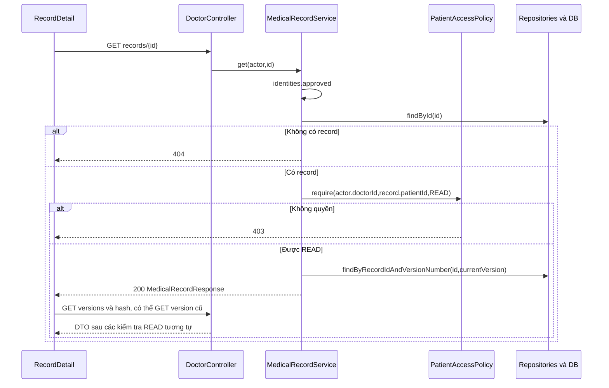

# 08 — Xem bệnh án và phiên bản có kiểm soát quyền

[← Mục lục](00_INDEX.md)

> Căn cứ: source đang có ngày 17/11/2026. Đây là phân tích tĩnh, không chạy API/test trong lượt viết tài liệu. Kết quả test ở handoff là bằng chứng lịch sử, không phải kiểm chứng Supabase hiện tại. SQL bên dưới chỉ minh họa tương đương logic, không phải log Hibernate.

## A. Chức năng này dùng để làm gì?

Doctor APPROVED có READ xem hồ sơ hiện tại hoặc phiên bản cũ. Từng tạo hồ sơ không thay thế consent hiện hành. Đọc nội dung, lịch sử, hash và download đều có kiểm tra quyền; các API này không trả toàn bộ Entity.

## B. Các file tham gia vào flow

Thứ tự là đường đi logic của request; filter chạy trước Controller. Các hàm phụ và chiều trả response có thể quay lại file đã đi qua.

| Thứ tự | File | Class/Method | Nhiệm vụ |
|---|---|---|---|
| 1 | [App.jsx](../../../frontend/src/App.jsx#L89) | `RecordDetail; useLoad; LoadState` | Tải nhiều tài nguyên và render |
| 2 | [api.js](../../../frontend/src/api.js#L28) | `api.record; versions; version; hash` | Các GET theo ID và version |
| 3 | [JwtAuthenticationFilter.java](../../src/main/java/com/blockchaincb/demo/security/JwtAuthenticationFilter.java#L29) | `doFilterInternal` | Account hiện hành |
| 4 | [DoctorController.java](../../src/main/java/com/blockchaincb/demo/controller/DoctorController.java#L86) | `get; versions; version; hash` | Nhận path và principal |
| 5 | [MedicalRecordService.java](../../src/main/java/com/blockchaincb/demo/service/MedicalRecordService.java#L149) | `get; allowed; version; response` | Ràng buộc approved/READ và chuyển DTO |
| 6 | [DatabasePatientAccessPolicy.java](../../src/main/java/com/blockchaincb/demo/service/DatabasePatientAccessPolicy.java#L22) | `require(READ)` | Kiểm tra grant hiện hành |
| 7 | [MedicalRecordRepository.java](../../src/main/java/com/blockchaincb/demo/repository/MedicalRecordRepository.java#L10) | `findById (kế thừa)` | Lấy record và patientId |
| 8 | [RecordVersionRepository.java](../../src/main/java/com/blockchaincb/demo/repository/RecordVersionRepository.java#L9) | `findByRecordIdAndVersionNumber` | Đúng version của record |
| 9 | [MedicalRecordResponse.java](../../src/main/java/com/blockchaincb/demo/dto/MedicalRecordResponse.java#L7) | `MedicalRecordResponse.VersionResponse` | DTO trả nội dung |

## C. Sơ đồ luồng hoạt động



## D. Giải thích toàn bộ flow từng bước

### Bước 1: Mở trang và chuỗi request

RecordTable link tới /records/:id. RecordDetail giữ page danh sách version và number phiên bản đang chọn. useLoad async gọi api.record trước, rồi api.versions; n=number hoặc currentVersion. Nếu number được chọn nó gọi api.version riêng, nếu không dùng r.version đã có. Cuối cùng gọi api.hash. Các lời gọi trong loader đang tuần tự, không phải Promise.all. Chỉ khi tất cả xong LoadState mới render chi tiết.

### Bước 2: JWT và đường dẫn

Mỗi GET có cùng Bearer header nhưng đều được filter xác thực riêng. @PathVariable @Positive ràng buộc id/number. Controller.get gọi records.get(p,id); không nhận Doctor ID riêng. Nếu số ID sai kiểu hoặc không dương, validation/handler trả 400.

### Bước 3: allowed là cửa kiểm soát chính

MedicalRecordService có @Transactional ở class cho cả đọc/ghi. allowed gọi identities.approved, tìm record bằng records.findById(id) hoặc404, rồi require READ dựa r.patientId trong DB. Đọc record gốc trước khi kiểm quyền bệnh nhân không đồng nghĩa trả record ra client trước; nó chỉ dùng metadata để kiểm tra.

### Bước 4: Version phải thuộc đúng record

version(r,number) gọi findByRecordIdAndVersionNumber(r.id,number), không chỉ findById phiên bản. Optional rỗng trả404. get dùng currentVersion trong root; getVersion dùng số đã qua đường allowed. versions dùng query page theo recordId và sắp số giảm dần. Người đổi URL version vẫn bị ràng buộc record và READ.

### Bước 5: Tạo DTO trong transaction

response(r,v) dựng MedicalRecordResponse gồm id,patientId,createdBy,createdAt,updatedAt,currentVersion và VersionResponse. response(v) chọn nội dung khám, metadata người tạo/thời điểm, previous ID/hash, attachmentIds, contentHash/schema và ba trường blockchain. List.copyOf tách danh sách ID khỏi collection JPA. Không trả password, storageKey hoặc canonicalContent ở DTO.

### Bước 6: React hiển thị và bảo vệ dữ liệu cũ

LoadState chỉ gọi children(data) khi không loading/error. useLoad xóa data lúc bắt đầu tải và khi lỗi, dùng AbortController để hủy request khi đổi deps/unmount. Mỗi 30 giây/focus sẽ tải lại khi live=true; phát hiện thiếu quyền thì không render medical content cũ. API hash thất bại cũng làm toàn bộ chi tiết lỗi vì loader gộp các GET.

### Bước 7: Audit của việc đọc

AuditFilter ghi ATTEMPT rồi SUCCESS/DENIED/ERROR cho từng HTTP request sau nhận diện account. Một trang React chi tiết có thể tạo nhiều audit dòng vì record,versions,hash là các request khác nhau. READ không ghi thêm phiên bản nhưng vẫn có ghi nhật ký trong transaction riêng.

### Request/response minh họa theo contract source

GET /api/doctor/records/10 trả MedicalRecordResponse có currentVersion=2 và version.versionNumber=2; GET /api/doctor/records/10/versions/1 trả chỉ VersionResponse của v1. ID/phiên bản trong ví dụ là minh họa.

## E. Giải thích code quan trọng

[MedicalRecordService.java](../../src/main/java/com/blockchaincb/demo/service/MedicalRecordService.java#L45) — trích nguyên văn:

```java
  private MedicalRecord allowed(DoctorPrincipal actor, Long id, PatientAccessPolicy.Action action) {
    identities.approved(actor);
    var r = records.findById(id).orElseThrow(() -> new ApiException(404, "Khong tim thay ho so"));
    access.require(actor.doctorId(), r.getPatientId(), action);
    return r;
  }
```

Patient ID lấy từ record đã lưu. Nếu bỏ access.require, bác sĩ APPROVED có thể đoán record ID và đọc hồ sơ ngoài consent. identities.approved và READ đều cần thiết.

[MedicalRecordService.java](../../src/main/java/com/blockchaincb/demo/service/MedicalRecordService.java#L179) — trích nguyên văn:

```java
  public VersionResponse getVersion(DoctorPrincipal actor, Long id, int number) {
    return response(version(allowed(actor, id, PatientAccessPolicy.Action.READ), number));
  }
```

Truyền allowed(...) vào version(...) khiến quyền được kiểm tra trước khi chọn nội dung phiên bản cũ. Không có ngoại lệ cho người đã tạo hồ sơ.

[App.jsx](../../../frontend/src/App.jsx#L27) — trích nguyên văn:

```jsx
  const [state, setState] = useState({ data: null, error: '', loading: true });
```

useState ban đầu data=null. useLoad không giữ một bản cache bệnh án lâu dài. Component chỉ giữ dữ liệu trong bộ nhớ React; đây không thay thế việc Backend từ chối các request thiếu quyền.

## F. Các trường hợp thành công và thất bại

| Trường hợp | Điều kiện | Kết quả | Code xử lý |
|---|---|---|---|
| Đọc hiện tại | Approved + active READ + record/version tồn tại | 200 DTO | get; response |
| Đọc bản cũ | READ còn hiệu lực | 200 VersionResponse | getVersion |
| Thu hồi quyền | Creator vẫn là mình nhưng grant revoked | 403 | allowed; require |
| Record/version thiếu | Không tìm thấy bằng khóa tương ứng | 404 | allowed; version |
| Một GET phụ lỗi | Hash/versions không tải được | Trang LoadState báo lỗi | RecordDetail.useLoad |

### Lưu ý hoặc rủi ro

allowed trả404 khi record không tồn tại nhưng403 khi record có mà thiếu quyền; khác biệt status có thể lộ sự tồn tại của ID, dù không trả nội dung. Polling không thu hồi bản sao người dùng đã đọc/tải về và không thông báo ngay lập tức như push. Đây là giới hạn hiện hữu cần hiểu.

### Đọc test để kiểm tra lại lập luận

[DemoApplicationTests.java](../../src/test/java/com/blockchaincb/demo/DemoApplicationTests.java#L390)

## G. Bài học rút ra

Record ID và version number là định vị dữ liệu, không phải quyền. Optional.orElseThrow tạo nhánh 404 rõ ràng. Map Entity sang DTO trong transaction giúp chủ động truy cập lazy collection và tránh serialize graph JPA.

### Câu hỏi tự kiểm tra

1. Một trang RecordDetail gọi ít nhất những GET nào?
2. Vì sao không tìm version chỉ bằng version ID?
3. Người tạo record mất READ có xem bản cũ được không?
4. canonicalContent có được trả ở MedicalRecordResponse không?
