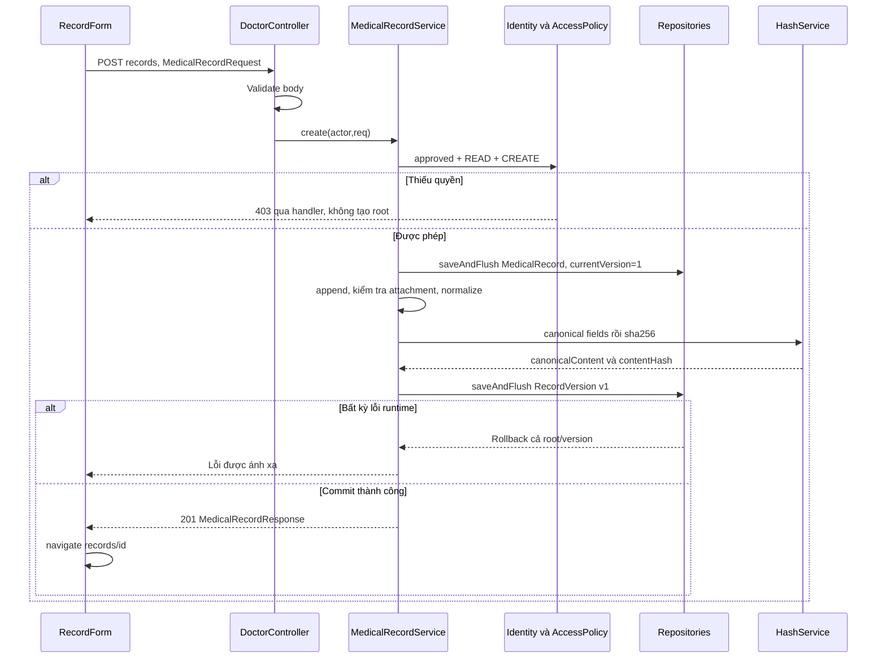

# 09 — Tạo hồ sơ khám và phiên bản đầu tiên

[← Mục lục](00_INDEX.md)

> Căn cứ: source đang có ngày 17/11/2026. Đây là phân tích tĩnh, không chạy API/test trong lượt viết tài liệu. Kết quả test ở handoff là bằng chứng lịch sử, không phải kiểm chứng Supabase hiện tại. SQL bên dưới chỉ minh họa tương đương logic, không phải log Hibernate.

## A. Chức năng này dùng để làm gì?

Bác sĩ APPROVED có cả READ và CREATE tạo một lần khám cho bệnh nhân. Giao dịch tạo MedicalRecord gốc và RecordVersion v1, hash đại diện nội dung rồi commit cùng nhau. Thông tin y tế nằm off-chain; không có RPC Ethereum hay giao dịch Blockchain ở flow này.

## B. Các file tham gia vào flow

Thứ tự là đường đi logic của request; filter chạy trước Controller. Các hàm phụ và chiều trả response có thể quay lại file đã đi qua.

| Thứ tự | File | Class/Method | Nhiệm vụ |
|---|---|---|---|
| 1 | [App.jsx](../../../frontend/src/App.jsx#L77) | `RecordForm; submit` | State nội dung và attachment IDs |
| 2 | [api.js](../../../frontend/src/api.js#L29) | `api.create` | POST records |
| 3 | [JwtAuthenticationFilter.java](../../src/main/java/com/blockchaincb/demo/security/JwtAuthenticationFilter.java#L29) | `JWT filter` | Danh tính |
| 4 | [DoctorController.java](../../src/main/java/com/blockchaincb/demo/controller/DoctorController.java#L71) | `create` | @ResponseStatus 201; @Valid DTO |
| 5 | [MedicalRecordRequest.java](../../src/main/java/com/blockchaincb/demo/dto/MedicalRecordRequest.java#L7) | `MedicalRecordRequest` | Ngày, nội dung, patient, attachmentIds |
| 6 | [MedicalRecordService.java](../../src/main/java/com/blockchaincb/demo/service/MedicalRecordService.java#L58) | `create; append; canonical; response` | Một transaction cho root và v1 |
| 7 | [DoctorIdentityService.java](../../src/main/java/com/blockchaincb/demo/security/DoctorIdentityService.java#L28) | `approved` | Account APPROVED |
| 8 | [DatabasePatientAccessPolicy.java](../../src/main/java/com/blockchaincb/demo/service/DatabasePatientAccessPolicy.java#L22) | `require READ rồi CREATE` | Consent theo actor |
| 9 | [MedicalRecordRepository.java](../../src/main/java/com/blockchaincb/demo/repository/MedicalRecordRepository.java#L10) | `saveAndFlush (kế thừa)` | Insert root và nhận ID |
| 10 | [AttachmentService.java](../../src/main/java/com/blockchaincb/demo/service/AttachmentService.java#L75) | `forVersion; descriptors` | Kiểm tra tệp đúng patient/uploader |
| 11 | [HashService.java](../../src/main/java/com/blockchaincb/demo/service/HashService.java#L14) | `normalize; canonical; sha256` | Chuẩn hóa và digest |
| 12 | [RecordVersionRepository.java](../../src/main/java/com/blockchaincb/demo/repository/RecordVersionRepository.java#L8) | `saveAndFlush (kế thừa)` | Insert snapshot phiên bản |
| 13 | [MedicalRecord.java](../../src/main/java/com/blockchaincb/demo/entity/MedicalRecord.java#L8) | `MedicalRecord` | Root metadata |
| 14 | [RecordVersion.java](../../src/main/java/com/blockchaincb/demo/entity/RecordVersion.java#L9) | `RecordVersion` | Snapshot nội dung bất biến theo ORM |

## C. Sơ đồ luồng hoạt động



## D. Giải thích toàn bộ flow từng bước

### Bước 1: Chọn patient và bản nháp

RecordForm lấy patientId từ query string hoặc người dùng nhập; không lấy doctorId từ form. form state chứa examDate, diagnosis, prescription, testResults, notes. files state là ID tệp đã upload, không phải bytes. Thay patient sẽ xóa danh sách file đã chọn. allowed useLoad gọi patientRecords để kiểm tra READ trước; response danh sách không cho biết CREATE nên Backend kiểm tra CREATE lúc lưu.

### Bước 2: Chuẩn bị DTO

submit(e) tạo content={...form,patientId:Number(patient),attachmentIds:files}, gọi api.create nếu chưa có existing. Ngày HTML date là yyyy-MM-dd. Diagnosis bắt buộc; các trường còn lại có thể là chuỗi rỗng nhưng không null. upload phải xong trước khi submit vì nút bị disabled khi uploading.

### Bước 3: Đi qua Controller

POST /api/doctor/records, JSON, Bearer. JwtAuthenticationFilter/AuditFilter chạy trước MVC. DoctorController.create có @Valid @RequestBody và @ResponseStatus(HttpStatus.CREATED), nhận actor bằng @AuthenticationPrincipal. DTO yêu cầu positive patientId, @PastOrPresent examDate, diagnosis @NotBlank/max10000, ba text khác @NotNull/max10000, list tối đa10 ID positive/nonnull.

### Bước 4: Quyền và thời điểm transaction

MedicalRecordService @Transactional ở class mở transaction trước create. identities.approved(actor) kiểm tra User/Doctor hiện hành, access.require READ rồi CREATE lấy grant hiệu lực với khóa đọc. Patient ID từ client chỉ là tài nguyên cần kiểm tra; createdBy lấy actor.doctorId. Thiếu quyền ném lỗi trước khi tạo MedicalRecord.

### Bước 5: Tạo root để có định danh

MedicalRecord không lưu diagnosis. Nó chứa patientId, createdBy, createdAt, updatedAt, currentVersion và lockVersion. create set createdAt=now() cắt tới microsecond; updatedAt giống createdAt, currentVersion=1. records.saveAndFlush insert root để có ID identity cho v.recordId và canonical content. Flush gửi SQL nhưng chưa commit; root vẫn được rollback nếu append thất bại.

### Bước 6: Kiểm tra attachment và dựng v1

append gọi attachments.forVersion với inheritedIds rỗng vì chưa có phiên bản trước. Hàm này chặn ID trùng, tệp thiếu, sai bệnh nhân hoặc uploader khác. Version mới nhận recordId/root.currentVersion/doctorId/thời điểm/ngày và text đã HashService.normalize. attachmentIds được sao ArrayList giữ thứ tự. v1 không có previousVersionId/previousHash, canonicalSchema=doctor-record-v1, blockchainStatus=NOT_SUBMITTED.

### Bước 7: Canonical rồi SHA-256

canonical(r,v) gọi attachments.descriptors để lấy metadata, xếp các trường theo thứ tự cố định; thêm mỗi file ID, sha256, mediaType, sizeBytes. HashService.canonical tạo chuỗi length-prefixed UTF-8, sha256(canonical) tạo 64 hex thường. Lưu cả canonicalContent snapshot và contentHash. Việc có snapshot không đồng nghĩa có bằng chứng độc lập ngoài DB; đọc sâu ở flow11.

### Bước 8: Lưu version và response

versions.saveAndFlush(v) insert record_versions; ElementCollection lưu version_attachments nếu có file. response(r,v) tạo DTO đầy đủ trong transaction. Commit thành công trước khi Controller hoàn tất 201. React navigate /records/{r.id} và RecordDetail lại đọc bằng API thật. Khi có lỗi, fail(e) báo error; 401/403 xóa draft/tệp và khóa form. Không tự retry POST để tránh tạo trùng khi kết quả commit không rõ.

### Request/response minh họa theo contract source

Request minh họa, không thực thi:
```json
{"patientId":1,"examDate":"2026-11-17","diagnosis":"Nội dung minh họa","prescription":"","testResults":"","notes":"","attachmentIds":[]}
```
Response 201 có id=10, patientId=1, createdBy=<Doctor ID từ principal>, currentVersion=1; version có versionNumber=1, previousVersionId=null, previousHash=null, contentHash=<64 hex>, blockchainStatus=NOT_SUBMITTED. ID và hash minh họa, không giả làm kết quả API đã chạy.

## E. Giải thích code quan trọng

[MedicalRecordService.java](../../src/main/java/com/blockchaincb/demo/service/MedicalRecordService.java#L58) — trích nguyên văn:

```java
  public MedicalRecordResponse create(DoctorPrincipal actor, MedicalRecordRequest req) {
    identities.approved(actor);
    access.require(actor.doctorId(), req.patientId(), PatientAccessPolicy.Action.READ);
    access.require(actor.doctorId(), req.patientId(), PatientAccessPolicy.Action.CREATE);
    var r = new MedicalRecord();
    r.setPatientId(req.patientId());
    r.setCreatedBy(actor.doctorId());
    r.setCreatedAt(now());
    r.setUpdatedAt(r.getCreatedAt());
    r.setCurrentVersion(1);
    records.saveAndFlush(r);
    var v = append(r, actor, req, null);
    return response(r, v);
  }

```

Ba kiểm tra đầu tách account khỏi consent. new MedicalRecord tạo root, không phải đã tạo v1. saveAndFlush phải trước append để root ID tham gia hash. Bỏ append thì root không có nội dung; bỏ transaction có thể để root mồ côi sau lỗi tệp.

[MedicalRecordService.java](../../src/main/java/com/blockchaincb/demo/service/MedicalRecordService.java#L113) — trích nguyên văn:

```java
    v.setCanonicalSchema(HashService.SCHEMA);
    v.setBlockchainStatus("NOT_SUBMITTED");
    String canonical = canonical(r, v);
    v.setCanonicalContent(canonical);
    v.setContentHash(hash.sha256(canonical));
    return versions.saveAndFlush(v);
```

Schema version hóa quy tắc hash. NOT_SUBMITTED nói đúng hiện trạng không có ghi on-chain; không phải pending transaction Ethereum. sha256 nhận canonical đã chuẩn hóa và được lưu cùng snapshot.

[MedicalRecordRequest.java](../../src/main/java/com/blockchaincb/demo/dto/MedicalRecordRequest.java#L7) — trích nguyên văn:

```java
public record MedicalRecordRequest(
    @NotNull @Positive Long patientId,
    @NotNull @PastOrPresent LocalDate examDate,
    @NotBlank @Size(max = 10000) String diagnosis,
    @NotNull @Size(max = 10000) String prescription,
    @NotNull @Size(max = 10000) String testResults,
    @NotNull @Size(max = 10000) String notes,
    @NotNull @Size(max = 10) List<@NotNull @Positive Long> attachmentIds) {
  @Override
```

DTO không có doctorId hay approvalStatus, ngăn client chọn tác giả. Validation list đi vào từng phần tử nhờ type-use annotation List<@NotNull @Positive Long>. Nếu chỉ kiểm tra list khác null thì phần tử null vẫn có thể lọt.

## F. Các trường hợp thành công và thất bại

| Trường hợp | Điều kiện | Kết quả | Code xử lý |
|---|---|---|---|
| Tạo thành công | Approved + READ/CREATE, DTO/tệp hợp lệ | 201 root và v1 | create → append |
| Thiếu CREATE | Chỉ có READ | 403; không insert root | access.require |
| Dữ liệu sai | Ngày tương lai, diagnosis rỗng, tệp >10 | 400 | @Valid |
| Tệp không hợp lệ | Sai patient/uploader hoặc ID thiếu | 403/400, rollback root | forVersion |
| DB lỗi khi lưu version | Constraint/optimistic lỗi | Rollback và lỗi tương ứng | transaction + handler |
| Audit kết quả lỗi | DB có thể đã commit | 503; kiểm tra lịch sử trước retry | AuditFilter |

### Lưu ý hoặc rủi ro

Schema record/grant/attachment mới thuộc đề xuất/H2; không khẳng định bảng đã áp dụng Supabase. Kiểm tra tồn tại Patient/grant không xác minh quyền do Patient module cấp nếu dữ liệu consent bị ghi sai. Không có idempotency key, nên lỗi mạng/503 cần kiểm tra kết quả trước khi gửi lại.

### Đọc test để kiểm tra lại lập luận

[DemoApplicationTests.java](../../src/test/java/com/blockchaincb/demo/DemoApplicationTests.java#L328) và [DemoApplicationTests.java](../../src/test/java/com/blockchaincb/demo/DemoApplicationTests.java#L654)

## G. Bài học rút ra

Constructor DI của MedicalRecordService nhận interface PatientAccessPolicy, hai repository, identity, AttachmentService và HashService. Nó điều phối thay vì tự mở connection SQL/RPC. Transaction đảm bảo root và version là một đơn vị; filesystem upload trước đó không nằm trong cùng transaction DB.

### Câu hỏi tự kiểm tra

1. Vì sao diagnosis không nằm trong MedicalRecord?
2. saveAndFlush root xong, v1 lỗi thì root còn không?
3. createdBy lấy từ đâu?
4. Vì sao cần root ID trước khi tính contentHash?
5. Upload tệp thành công có nghĩa đã tạo hồ sơ chưa?
