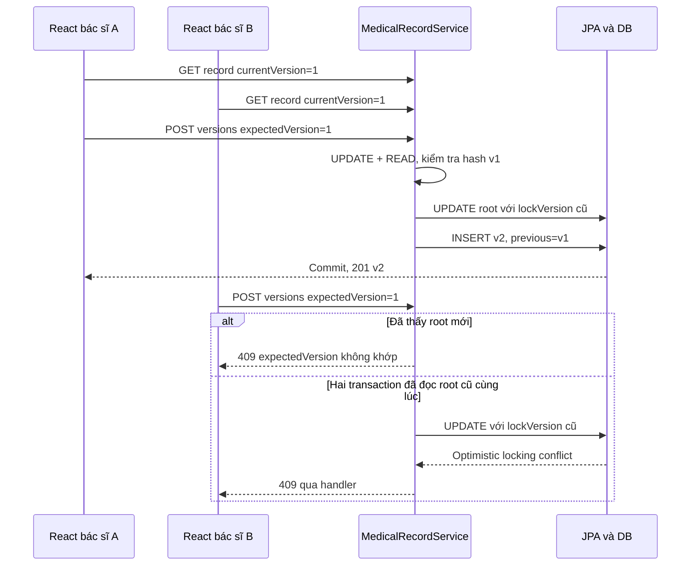

# 10 — Cập nhật bằng phiên bản mới và kiểm soát đồng thời

[← Mục lục](00_INDEX.md)

> Căn cứ: source đang có ngày 17/11/2026. Đây là phân tích tĩnh, không chạy API/test trong lượt viết tài liệu. Kết quả test ở handoff là bằng chứng lịch sử, không phải kiểm chứng Supabase hiện tại. SQL bên dưới chỉ minh họa tương đương logic, không phải log Hibernate.

## A. Chức năng này dùng để làm gì?

Cập nhật là thêm snapshot mới, không ghi đè v1. Bác sĩ APPROVED có READ+UPDATE được sửa hồ sơ, không bắt buộc là người tạo gốc. Cần biết phiên bản mình đã đọc thông qua expectedVersion; Backend còn dùng optimistic lock của DB để chặn race condition.

## B. Các file tham gia vào flow

Thứ tự là đường đi logic của request; filter chạy trước Controller. Các hàm phụ và chiều trả response có thể quay lại file đã đi qua.

| Thứ tự | File | Class/Method | Nhiệm vụ |
|---|---|---|---|
| 1 | [App.jsx](../../../frontend/src/App.jsx#L76) | `EditRecord; RecordForm.submit` | Đọc hiện tại, giữ draft, gửi expectedVersion |
| 2 | [api.js](../../../frontend/src/api.js#L30) | `api.update` | POST versions |
| 3 | [DoctorController.java](../../src/main/java/com/blockchaincb/demo/controller/DoctorController.java#L93) | `append` | 201 và nested validation |
| 4 | [UpdateRecordRequest.java](../../src/main/java/com/blockchaincb/demo/dto/UpdateRecordRequest.java#L6) | `UpdateRecordRequest` | expectedVersion + @Valid content |
| 5 | [MedicalRecordService.java](../../src/main/java/com/blockchaincb/demo/service/MedicalRecordService.java#L73) | `update; allowed; version; canonical; append` | Kiểm tra và tăng phiên bản |
| 6 | [DatabasePatientAccessPolicy.java](../../src/main/java/com/blockchaincb/demo/service/DatabasePatientAccessPolicy.java#L22) | `require UPDATE và READ` | Grant hiện hành |
| 7 | [MedicalRecord.java](../../src/main/java/com/blockchaincb/demo/entity/MedicalRecord.java#L73) | `MedicalRecord.lockVersion` | Optimistic lock JPA |
| 8 | [RecordVersion.java](../../src/main/java/com/blockchaincb/demo/entity/RecordVersion.java#L9) | `RecordVersion` | Snapshot không update bằng ORM |
| 9 | [RecordVersionRepository.java](../../src/main/java/com/blockchaincb/demo/repository/RecordVersionRepository.java#L9) | `findByRecordIdAndVersionNumber; saveAndFlush` | Đọc trước và insert mới |
| 10 | [GlobalExceptionHandler.java](../../src/main/java/com/blockchaincb/demo/exception/GlobalExceptionHandler.java#L43) | `conflict` | Ánh xạ concurrency 409 |

## C. Sơ đồ luồng hoạt động



## D. Giải thích toàn bộ flow từng bước

### Bước 1: Nạp bản đang chỉnh sửa

EditRecord gọi api.record(id) bằng useLoad(...,[id],false). live=false tắt auto polling/focus ở loader cha để không remount form làm mất draft. RecordForm nhận existing; form và attachment IDs khởi tạo từ existing.version, patient bị disabled không cho đổi. existing.currentVersion là số phiên bản dùng làm expectedVersion khi submit. Loader kiểm tra READ trong form vẫn tự làm mới.

### Bước 2: Hợp đồng HTTP

POST /api/doctor/records/{id}/versions, không phải PUT sửa version cũ. Body có expectedVersion số nguyên @Positive và content @NotNull @Valid MedicalRecordRequest. Nói “expectedVersion là lockVersion JPA” là sai: chúng là hai trường riêng. Controller.append gọi records.update rồi trả201 khi thành công.

### Bước 3: Quyền, ID và số phiên bản

update đầu tiên allowed(actor,id,UPDATE), rồi require READ. PatientId trong content phải bằng r.patientId từ DB, nếu khác400. Nếu r.currentVersion khác expectedVersion thì409 trước khi sửa root. Điều này báo bản mà người dùng đang sửa đã cũ, tránh âm thầm ghi tiếp trên nội dung khác.

### Bước 4: Kiểm tra bản trước

version(r,currentVersion) lấy snapshot liền trước. Backend tính lại sha256(canonical(r,previous)) từ các cột và metadata file, đồng thời sha256(previous.canonicalContent). Cả hai phải khớp previous.contentHash; sai thì409. Nó không đọc bytes file ở bước này, không tự quét toàn bộ chuỗi lịch sử, không xác minh Blockchain.

### Bước 5: Sửa root và flush khóa lạc quan

r.currentVersion tăng một và updatedAt=now. records.flush() phát SQL UPDATE root với điều kiện lockVersion cũ của @Version. Hibernate tăng lockVersion khi cập nhật thành công; nếu hàng đã được writer khác đổi, điều kiện không còn khớp và phát optimistic exception. Service không tự setLockVersion để giả vượt qua khóa. Nếu flush lỗi, chưa append v mới; transaction rollback.

### Bước 6: append phiên bản bất biến

append tạo new RecordVersion, đặt previousVersionId=previous.id và previousHash=previous.contentHash. Các text được chuẩn hóa, snapshot/canonical/hash mới được lưu. File mới phải do actor upload; file từ previous.attachmentIds có thể được kế thừa bởi bác sĩ khác được UPDATE. RecordVersion @Immutable và các cột updatable=false bảo vệ hướng ORM, UNIQUE(record_id,version_number) trong SQL là lớp bổ sung.

### Bước 7: Ví dụ v1 → v2 → v3

Giả sử record=10, v1 id=101 có hash H1, previous null. Request expectedVersion=1 tạo v2 id=102, previousVersionId=101, previousHash=H1 và hash H2. Sau khi đọc lại currentVersion=2, request expectedVersion=2 tạo v3 id=103, previousVersionId=102, previousHash=H2 và hash H3. H1/H2/H3 là ký hiệu, không phải hex thật; lockVersion có thể tăng nhưng không hứa bằng 1/2/3. Không có UPDATE diagnosis của101/102.

### Bước 8: 409, rollback và phản hồi React

ApiException 409, OptimisticLockingFailureException, OptimisticLockException hoặc DataIntegrityViolationException có handler409. Root và insertversion nằm trong cùng transaction nên lỗi cuối cũng rollback cập nhật root. React giữ draft khi409, hiển thị thông báo tải lại; không tự ghi đè/retry. Thành công navigate về /records/id và đọc lại. Người dùng cần chủ động đối chiếu draft với nội dung mới.

### Request/response minh họa theo contract source

Ví dụ payload:
```json
{"expectedVersion":1,"content":{"patientId":1,"examDate":"2026-11-17","diagnosis":"Bổ sung minh họa","prescription":"","testResults":"","notes":"","attachmentIds":[]}}
```
Response 201 chứa currentVersion=2 và version.previousVersionId/hash nối bản1; response409 chứa status,message, không phải bản ghi đè thành công.

## E. Giải thích code quan trọng

[MedicalRecordService.java](../../src/main/java/com/blockchaincb/demo/service/MedicalRecordService.java#L78) — trích nguyên văn:

```java
    if (r.getCurrentVersion() != req.expectedVersion())
      throw new ApiException(409, "Phien ban da thay doi");
    var previous = version(r, r.getCurrentVersion());
    if (!hash.sha256(canonical(r, previous)).equals(previous.getContentHash())
        || !hash.sha256(previous.getCanonicalContent()).equals(previous.getContentHash()))
      throw new ApiException(409, "Phien ban truoc khong con nguyen ven");
    r.setCurrentVersion(r.getCurrentVersion() + 1);
    r.setUpdatedAt(now());
    // Optimistic root lock is flushed before appending the new immutable version.
    records.flush();
    return response(r, append(r, actor, req.content(), previous));
  }

```

if expectedVersion bảo vệ ý định của người dùng; kiểm tra hash bảo vệ tính nhất quán off-chain; flush bảo vệ cạnh tranh sau lúc đọc. Bỏ một lớp không được lớp khác thay thế hoàn toàn.

[MedicalRecord.java](../../src/main/java/com/blockchaincb/demo/entity/MedicalRecord.java#L73) — trích nguyên văn:

```java
  @Version private Long lockVersion;
```

@Version báo Hibernate quản lý lockVersion. Đây không phải annotation cho lịch sử khám; r.currentVersion và bảng record_versions mới thể hiện version nghiệp vụ. Bỏ @Version để lại khoảng trống hai transaction cùng vượt if expectedVersion.

[MedicalRecordService.java](../../src/main/java/com/blockchaincb/demo/service/MedicalRecordService.java#L109) — trích nguyên văn:

```java
    if (previous != null) {
      v.setPreviousVersionId(previous.getId());
      v.setPreviousHash(previous.getContentHash());
    }
    v.setCanonicalSchema(HashService.SCHEMA);
```

Nối bằng cả ID và hash giúp truy vết phiên bản liền trước và đưa hash trước vào canonical của bản mới. Nếu bỏ previousHash, không còn liên kết hash như thiết kế hiện tại.

## F. Các trường hợp thành công và thất bại

| Trường hợp | Điều kiện | Kết quả | Code xử lý |
|---|---|---|---|
| Cập nhật hợp lệ | Expected khớp, hash trước đúng, UPDATE+READ | 201 snapshot mới | update → append |
| Bản cũ | currentVersion != expectedVersion | 409 | update |
| Race thực sự | Hai transaction đã đọc cùng root | Một commit; bên còn lại conflict | @Version + flush |
| Đổi bệnh nhân | content.patientId khác root | 400 | update |
| Mất toàn vẹn | Hash snapshot/cột trước không khớp | 409 | update |
| Thiếu quyền | Creator nhưng không active grant | 403 | allowed; require |

### Lưu ý hoặc rủi ro

Không có auto merge nội dung hoặc idempotency. Test concurrency hiện dùng H2, không chứng minh mọi hành vi locking của PostgreSQL/Supabase. @Immutable chủ yếu bảo vệ cập nhật ORM, không chặn SQL của tài khoản đặc quyền. API khác trả currentVersion root và versionNumber bản đang xem có thể khác nhau.

### Đọc test để kiểm tra lại lập luận

[DemoApplicationTests.java](../../src/test/java/com/blockchaincb/demo/DemoApplicationTests.java#L567); cùng file: hashVerificationDetectsChangedMedicalFieldsAndBlocksAppend và versionsAreAppendOnlyLinkedHashedAndStaleUpdateConflicts.

## G. Bài học rút ra

Nhớ optimistic lock là “phát hiện xung đột lúc ghi”, không phải khóa chặn tất cả người đọc. PESSIMISTIC_READ trên grant và @Version trên root giải quyết hai việc khác nhau. @Immutable không biến DB thành sổ cái không thể bị admin sửa.

### Câu hỏi tự kiểm tra

1. expectedVersion khác lockVersion thế nào?
2. Hai người cùng vượt if expectedVersion thì còn gì bảo vệ?
3. Vì sao flush trước append vẫn có thể rollback cả root?
4. previousHash của v3 là H1 hay H2?
5. Tệp kế thừa có cần cùng uploader với bác sĩ cập nhật không?
