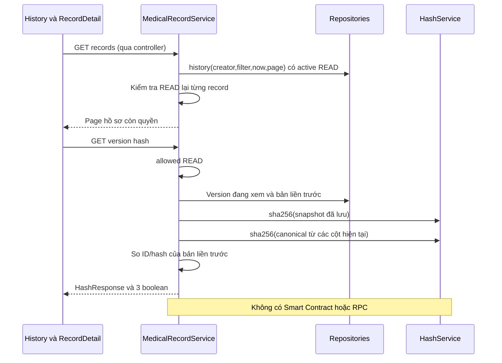

# 11 — Lịch sử hồ sơ và bằng chứng SHA-256 off-chain

[← Mục lục](00_INDEX.md)

> Căn cứ: source đang có ngày 17/11/2026. Đây là phân tích tĩnh, không chạy API/test trong lượt viết tài liệu. Kết quả test ở handoff là bằng chứng lịch sử, không phải kiểm chứng Supabase hiện tại. SQL bên dưới chỉ minh họa tương đương logic, không phải log Hibernate.

## A. Chức năng này dùng để làm gì?

Doctor xem hồ sơ mình từng tạo khi còn READ; xem version và kiểm tra snapshot/cột nội dung/liên kết trước có khớp hash. Lịch sử theo tác giả không cấp quyền vĩnh viễn. Đây là bước cần hiểu trước Solidity: hash hiện được giữ cùng dữ liệu trong DB, chưa có bằng chứng độc lập on-chain.

## B. Các file tham gia vào flow

Thứ tự là đường đi logic của request; filter chạy trước Controller. Các hàm phụ và chiều trả response có thể quay lại file đã đi qua.

| Thứ tự | File | Class/Method | Nhiệm vụ |
|---|---|---|---|
| 1 | [App.jsx](../../../frontend/src/App.jsx#L74) | `History; RecordDetail` | Lọc patient, chọn version, hiển thị hash |
| 2 | [api.js](../../../frontend/src/api.js#L26) | `api.records; versions; version; hash` | GET lịch sử/phiên bản/hash |
| 3 | [DoctorController.java](../../src/main/java/com/blockchaincb/demo/controller/DoctorController.java#L77) | `history; versions; hash` | Nhận principal và phân trang |
| 4 | [MedicalRecordService.java](../../src/main/java/com/blockchaincb/demo/service/MedicalRecordService.java#L163) | `history; versions; hash; canonical` | Quyền, query và so hash |
| 5 | [MedicalRecordRepository.java](../../src/main/java/com/blockchaincb/demo/repository/MedicalRecordRepository.java#L20) | `history` | Creator + active READ |
| 6 | [RecordVersionRepository.java](../../src/main/java/com/blockchaincb/demo/repository/RecordVersionRepository.java#L11) | `findByRecordIdOrderByVersionNumberDesc` | Trang version theo số giảm dần |
| 7 | [AttachmentService.java](../../src/main/java/com/blockchaincb/demo/service/AttachmentService.java#L93) | `descriptors` | Metadata tệp để tái tạo canonical |
| 8 | [HashService.java](../../src/main/java/com/blockchaincb/demo/service/HashService.java#L40) | `canonical; normalize; sha256` | Quy tắc digest |
| 9 | [RecordVersion.java](../../src/main/java/com/blockchaincb/demo/entity/RecordVersion.java#L145) | `RecordVersion` | Snapshot, digest và previous link |

## C. Sơ đồ luồng hoạt động



## D. Giải thích toàn bộ flow từng bước

### Bước 1: History không phải mọi record đã từng truy cập

History giữ filter patientID và page; api.records gửi GET /api/doctor/records?patientId=... khi có lọc. Service.history gọi approved, repository.history đòi createdBy=actor.doctorId và EXISTS grant READ còn hiệu lực. Sau query còn access.require READ mỗi record khi map response. Hồ sơ do người khác tạo nhưng mình được xem nằm ở danh sách patientRecords, không tự xuất hiện trong lịch sử do mình tạo.

### Bước 2: Version list và chọn nội dung

api.versions gọi GET /records/{id}/versions; allowed READ chạy trước query findByRecordIdOrderByVersionNumberDesc. DTO VersionResponse có versionNumber, doctorId, createdAt và hash, không có currentVersion root. RecordDetail giữ number đã chọn, gọi api.version và api.hash theo number đó; lịch sử phân trang giữ page riêng.

### Bước 3: Tạo canonical lúc ghi

append đã normalize diagnosis/prescription/testResults/notes. canonical(r,v) xếp theo thứ tự: canonicalSchema; recordId; patientId; versionNumber; doctorId; createdAt; previousVersionId; previousHash; examDate; diagnosis; prescription; testResults; notes; số file. Với mỗi file theo thứ tự: id,sha256,mediaType,sizeBytes. Không hash JSON tùy thứ tự key, không hash toString của cả Entity.

### Bước 4: Chuẩn hóa Unicode và newline

normalize quét UTF-16 để từ chối high/low surrogate không hợp lệ (400). Nó đổi CRLF rồi CR thành LF và dùng Normalizer.Form.NFC. Không trim nội dung y tế; khoảng trắng có ý nghĩa vẫn được giữ. now() ở MedicalRecordService cắt tới microsecond trước khi lưu thời gian để tái tạo từ DB ổn định hơn.

### Bước 5: Length-prefix UTF-8

canonical(Object... fields) biến null thành chuỗi rỗng, trường khác thành normalize(field.toString()). Mỗi trường thêm số byte UTF-8, dấu ":" và giá trị. Ví dụ canonical("é","x") cho "2:é1:x": chữ é có hai byte. canonical("ab","c") khác canonical("a","bc"), dù nối trần đều thành abc. Schema cố định và kiểu/ràng buộc trường giúp diễn giải; hàm generic tự nó không phân biệt null với chuỗi rỗng.

### Bước 6: Digest và nơi lưu

sha256(String) lấy bytes UTF-8 rồi gọi overload sha256(byte[]). MessageDigest SHA-256 trả32 byte; HexFormat.of().formatHex cho64 ký tự hex thường. append lưu canonicalContent và contentHash trong cùng version. SHA-256 không mã hóa để đọc lại được và không dùng thay BCrypt. HashServiceTest có vector abc chuẩn để kiểm tra thuật toán, không cần dữ liệu thật.

### Bước 7: Ba phép kiểm tra ở hash endpoint

hash(actor,id,number) trước hết allowed READ, lấy v và nếu number>1 lấy version number-1. storedSnapshotMatchesHash so digest của canonicalContent đã lưu với contentHash; currentContentMatchesHash so digest tái tạo từ cột/metadata với contentHash; previousLinkMatches so previous.id và contentHash với v.previousVersionId/previousHash. Với v1 nó kiểm tra previousId/hash đều null. Sai hash vẫn HTTP200 với cờ false để UI cảnh báo, không tự ném409 tại hash endpoint.

### Bước 8: Giới hạn và React

RecordDetail hiện ba cờ, hash và NOT_SUBMITTED; một cờ false hiện cảnh báo. Nếu record fields bị sửa mà snapshot/hash còn nguyên, snapshot=true nhưng current=false. Nếu kẻ có quyền sửa cả cột, snapshot và hash đồng bộ, cả hai có thể true: không có anchor ngoài DB để phát hiện. hash endpoint kiểm tra liên kết liền trước, không duyệt toàn chuỗi hay đọc bytes mọi file; download mới kiểm bytes file. Cần Blockchain sau này để neo digest độc lập.

### Request/response minh họa theo contract source

HashResponse minh họa: {"recordId":10,"versionNumber":2,"algorithm":"SHA-256","canonicalSchema":"doctor-record-v1","hash":"<64_HEX>","previousHash":"<HASH_V1>","blockchainStatus":"NOT_SUBMITTED","storedSnapshotMatchesHash":true,"currentContentMatchesHash":true,"previousLinkMatches":true}. Không có transaction hash thành công.

## E. Giải thích code quan trọng

[HashService.java](../../src/main/java/com/blockchaincb/demo/service/HashService.java#L40) — trích nguyên văn:

```java
  public String canonical(Object... fields) {
    StringBuilder out = new StringBuilder();
    for (Object field : fields) {
      String value = field == null ? "" : normalize(field.toString());
      out.append(value.getBytes(StandardCharsets.UTF_8).length).append(':').append(value);
    }
    return out.toString();
  }
```

Object... là varargs cho danh sách trường có thứ tự. StringBuilder tránh nối tạo quá nhiều String trung gian. getBytes(UTF_8).length không phải String.length, rất quan trọng với tiếng Việt. Bỏ length prefix làm các ranh giới trường mơ hồ.

[HashService.java](../../src/main/java/com/blockchaincb/demo/service/HashService.java#L28) — trích nguyên văn:

```java
  public String sha256(byte[] bytes) {
    try {
      return HexFormat.of().formatHex(MessageDigest.getInstance("SHA-256").digest(bytes));
    } catch (NoSuchAlgorithmException impossible) {
      throw new IllegalStateException(impossible);
    }
  }
```

MessageDigest trả bytes, HexFormat chỉ biểu diễn hex; NoSuchAlgorithmException là lỗi môi trường thuật toán nên được bọc IllegalStateException. Không log nội dung hoặc raw bytes.

[MedicalRecordService.java](../../src/main/java/com/blockchaincb/demo/service/MedicalRecordService.java#L199) — trích nguyên văn:

```java
    boolean link =
        previous == null
            ? v.getPreviousVersionId() == null && v.getPreviousHash() == null
            : previous.getId().equals(v.getPreviousVersionId())
                && previous.getContentHash().equals(v.getPreviousHash());
    return new HashResponse(
        id,
```

So ID và hash của bản ngay trước. Chỉ so previousHash mà không ràng buộc ID/version có thể bỏ sót nối nhầm record. Không nên gọi cờ này là xác minh Ethereum.

## F. Các trường hợp thành công và thất bại

| Trường hợp | Điều kiện | Kết quả | Code xử lý |
|---|---|---|---|
| History hợp lệ | Creator và active READ | 200 Page | history query + require |
| Quyền bị thu hồi | Không còn grant | History loại record; GET trực tiếp403 | history/allowed |
| Nội dung bị sửa | Cột khác canonical gốc | 200 currentContentMatchesHash=false | hash |
| Bản/version thiếu | Không tìm thấy | 404 | version |
| UPDATE trên bản hỏng | Hash trước không khớp | 409 | update; khác endpoint hash |

### Lưu ý hoặc rủi ro

Canonical v1 dùng Instant.toString của dữ liệu đã cắt microsecond; khi đổi runtime/schema phải giữ quy tắc tương thích. Generic canonical mã hóa null và empty giống nhau; tính rõ nghĩa dựa vào schema/ràng buộc hiện tại. Không thay quy tắc v1 mà âm thầm tính lại hash cũ. Các cột blockchain_status chỉ cho NOT_SUBMITTED theo SQL đề xuất hiện có.

### Đọc test để kiểm tra lại lập luận

[HashServiceTest.java](../../src/test/java/com/blockchaincb/demo/HashServiceTest.java#L18); [DemoApplicationTests.java](../../src/test/java/com/blockchaincb/demo/DemoApplicationTests.java#L543)

## G. Bài học rút ra

Tách thuật toán SHA, quy tắc canonical và nguồn bằng chứng tin cậy. Nhớ Stream/Page.map xử lý response; varargs và list theo thứ tự giúp tạo dữ liệu đầu vào hash. Đừng nghĩ tất cả HTTP200 có nghĩa hash khớp: phải đọc boolean trong body.

### Câu hỏi tự kiểm tra

1. Vì sao hash JSON trực tiếp có thể không ổn định?
2. Vì sao é dùng độ dài2?
3. Snapshot=true/current=false nói điều gì?
4. previousLinkMatches có quét toàn chuỗi không?
5. Nếu admin DB sửa cả nội dung/hash thì kiểm tra off-chain còn đủ không?
