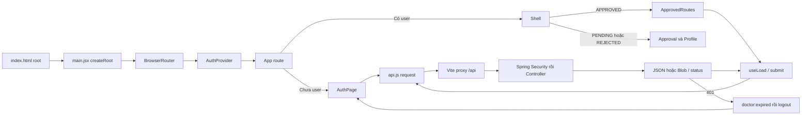

# 14 — React Router, Auth Context và Fetch từ đầu đến cuối

[← Mục lục](00_INDEX.md)

> Căn cứ: source đang có ngày 17/11/2026. Đây là phân tích tĩnh, không chạy API/test trong lượt viết tài liệu. Kết quả test ở handoff là bằng chứng lịch sử, không phải kiểm chứng Supabase hiện tại. SQL bên dưới chỉ minh họa tương đương logic, không phải log Hibernate.

## A. Chức năng này dùng để làm gì?

Tài liệu này ghép các màn hình thành một vòng đời frontend: bootstrap, chọn route, đăng nhập, gọi API, hiển thị loading/error/data và hủy phiên. React hỗ trợ UX và giữ dữ liệu trong bộ nhớ; quyền thật vẫn nằm tại Java Backend.

## B. Các file tham gia vào flow

Thứ tự là đường đi logic của request; filter chạy trước Controller. Các hàm phụ và chiều trả response có thể quay lại file đã đi qua.

| Thứ tự | File | Class/Method | Nhiệm vụ |
|---|---|---|---|
| 1 | [index.html](../../../frontend/index.html#L1) | `HTML entry` | Root DOM |
| 2 | [main.jsx](../../../frontend/src/main.jsx#L2) | `createRoot; BrowserRouter; AuthProvider` | Khởi tạo app |
| 3 | [App.jsx](../../../frontend/src/App.jsx#L7) | `AuthProvider; App; Shell; ApprovedRoutes` | Session context và route guard |
| 4 | [App.jsx](../../../frontend/src/App.jsx#L26) | `useLoad; LoadState` | Tải tài nguyên có abort/polling |
| 5 | [api.js](../../../frontend/src/api.js#L5) | `api wrappers; request; setToken` | Fetch cùng origin và Bearer |
| 6 | [vite.config.js](../../../frontend/vite.config.js#L5) | `Vite proxy /api` | Nối loopback Java |
| 7 | [SecurityConfig.java](../../src/main/java/com/blockchaincb/demo/config/SecurityConfig.java#L14) | `SecurityFilterChain` | Kiểm soát request ở server |
| 8 | [DoctorController.java](../../src/main/java/com/blockchaincb/demo/controller/DoctorController.java#L19) | `DoctorController` | Điểm nhận API nghiệp vụ |

## C. Sơ đồ luồng hoạt động



## D. Giải thích toàn bộ flow từng bước

### Bước 1: Bootstrap và Router

index.html có div#root và script /src/main.jsx. createRoot render StrictMode > BrowserRouter > AuthProvider > App. BrowserRouter dùng URL path để render component, không tự gọi Backend mỗi khi đổi route. StrictMode ở dev có thể chạy lại effect để kiểm cleanup; nó không có nghĩa mỗi click POST đều được chủ động gửi hai lần bởi code submit.

### Bước 2: Context và state phiên

Auth context ban đầu null, AuthProvider giữ user/active/notice bằng useState và expiry timer bằng useRef. useAuth đọc context trong component con. Token không nằm trong user state: module api.js giữ biến token và generation. setToken tăng generation để request cũ không dễ trả dữ liệu sang phiên mới. Không có rehydration từ localStorage/sessionStorage, nên reload phải login lại.

### Bước 3: Các route thực tế

App khai báo /login, /register và /*. Nếu chưa user, route bảo vệ Navigate /login replace. Có user thì Shell. Shell luôn có profile/approval; wildcard chỉ render ApprovedRoutes nếu approvalStatus=APPROVED. ApprovedRoutes có index Dashboard; patients; patients/:patientId; records; records/new; records/:id/edit; records/:id. Trang không tìm thấy hiện Empty. Route /approval tự chuyển / khi user đã APPROVED.

### Bước 4: Từ handler UI tới API

AuthPage dùng FormData; Patients dùng q/query/page; History dùng filter/page; Profile defaultValue input; RecordForm controlled state form/patient/files; RecordDetail giữ page và number. Gửi form dùng preventDefault và await để xử lý lỗi trong try/catch/finally. Các wrapper api.js chọn đúng HTTP method, đường dẫn, query encoding và body, thay vì để từng component tự viết header JWT.

### Bước 5: Fetch và proxy

request mặc định GET, nhận method/body/signal/blob. Token có thì thêm Authorization. FormData giữ nguyên body/boundary; body thường được JSON.stringify và Content-Type JSON. fetch luôn cache:no-store, credentials:omit, đường dẫn /api + path. Vite proxy target lấy DOCTOR_API_TARGET, default loopback8080; Browser thấy cùng origin5173, không cần mở CORS wildcard. Static build production vẫn cần reverse proxy và SPA fallback; Vite config không tự cấu hình server production.

### Bước 6: Request thành công và lỗi

response.ok false tạo ApiError(status,message Việt theo bảng), không dùng nguyên văn mọi Backend error. 401 với token sẽ setToken(null), dispatch doctor:expired; listener logout. 403 thường giữ phiên nhưng component/resource xóa nội dung lỗi; refresh /me bắt mọi lỗi không Abort thì logout. Request mạng lỗi thành ApiError0, AbortError được giữ. body thành công json() hoặc blob() tùy endpoint.

### Bước 7: useLoad và vòng đời dữ liệu

useLoad giữ {data,error,loading}; mỗi lần deps/tick/live đổi tạo AbortController và reset data=null. loader hoàn tất chỉ setState khi chưa aborted; cleanup abort và gỡ interval/focus. live=true tải lại30s/focus nếu document không hidden, live=false vẫn tải ban đầu/reload nhưng không polling. LoadState render Loading, ErrorBox+retry hoặc children(data). EditRecord dùng false để bảo vệ draft; các trang đọc dùng mặc định true.

### Bước 8: Đăng nhập, đăng xuất và UI

login thực hiện auth POST → setToken → GET me → setUser/active/timer. React đọc exp chỉ để timer UX. Logout clear timer/token/user/active, unmount Shell để xóa dữ liệu màn hình; không gọi endpoint logout server vì Java tắt logout built-in và chưa có revocation. AuthProvider làm mới /me để phát hiện bị khóa/đổi approval; UI không có nút tự Admin duyệt.

### Bước 9: Màn hình đặc thù

Dashboard gọi Promise.all patients/records để lấy totalElements thật. RecordDetail gọi tuần tự record,versions,version nếu chọn,hash. RecordForm kiểm quyền READ qua patientRecords; fail401/403 xóa draft; allowed.error bất kỳ cũng đặt denied. Download tạo Blob URL rồi revoke, upload dùng FormData và lưu ID. CSS có sidebar, breakpoint800/1200 và reduced motion, không ảnh hưởng quyền Backend.


## E. Giải thích code quan trọng

[App.jsx](../../../frontend/src/App.jsx#L26) — trích nguyên văn:

```jsx
export function useLoad(loader, deps = [], live = true) {
  const [state, setState] = useState({ data: null, error: '', loading: true });
  const [tick, setTick] = useState(0);
  useEffect(() => { const controller = new AbortController(); setState({ data: null, error: '', loading: true });
    loader(controller.signal).then(data => { if (!controller.signal.aborted) setState({ data, error: '', loading: false }); }).catch(e => { if (!controller.signal.aborted && e.name !== 'AbortError') setState({ data: null, error: e.message, loading: false }); });
    const reload = () => { if (!document.hidden) setTick(t => t + 1); };
    const timer = live ? setInterval(reload, 30000) : null; if (live) window.addEventListener('focus', reload);
```

Dependency array quyết định khi tải lại. AbortController cùng kiểm tra aborted ngăn setState của request không còn phù hợp. Nếu bỏ cleanup, route cũ có thể tiếp tục timer/request và trả dữ liệu vào thời điểm không mong muốn.

[api.js](../../../frontend/src/api.js#L12) — trích nguyên văn:

```javascript
  if (current !== generation) throw new DOMException('Phiên đã thay đổi', 'AbortError');
  if (!response.ok) {
    if (response.status === 401 && token) { setToken(null); window.dispatchEvent(new Event('doctor:expired')); }
    const messages = { 400: 'Dữ liệu không hợp lệ. Kiểm tra các trường và chuyên khoa.', 401: 'Phiên hết hạn hoặc email / mật khẩu không đúng. Vui lòng đăng nhập lại.', 403: 'Bạn không có quyền hiện hành cho thao tác này, hoặc tài khoản đã bị hạn chế.', 404: 'Không tìm thấy hồ sơ hoặc phiên bản.', 409: 'Dữ liệu trùng, đã thay đổi hoặc không còn toàn vẹn. Hãy tải lại trước khi lưu.', 413: 'Tệp vượt quá giới hạn 5 MiB.', 415: 'Định dạng gửi không được hỗ trợ.', 503: 'Dịch vụ lưu tệp hoặc nhật ký chưa sẵn sàng. Kiểm tra lịch sử trước khi thử gửi lại.' };
    throw new ApiError(response.status, messages[response.status] || 'Máy chủ chưa xử lý được yêu cầu. Vui lòng thử lại sau.');
  }
```

Mỗi thay đổi token tăng generation; response của thế hệ cũ bị coi AbortError trước khi trả body. 401 có event riêng để context cập nhật ngay. Không dùng HTTP403 làm bằng chứng phải xóa tất cả phiên vì có thể chỉ thiếu quyền một bệnh nhân.

[main.jsx](../../../frontend/src/main.jsx#L2) — trích nguyên văn:

```jsx
import { createRoot } from 'react-dom/client';
```

AuthProvider ở ngoài App giúp nhiều route dùng cùng context, thay vì mỗi màn hình tự giữ token độc lập. BrowserRouter cung cấp Link/Navigate/useParams cho các component con.

## F. Các trường hợp thành công và thất bại

| Trường hợp | Điều kiện | Kết quả | Code xử lý |
|---|---|---|---|
| Chưa user | Mở route records trực tiếp | Redirect login | App |
| Chưa approved | Có user PENDING/REJECTED | Approval/Profile | Shell |
| Đang tải | loader chưa xong | Loading, không render data cũ | useLoad; LoadState |
| JWT hết hạn | Backend401 hoặc timer exp | Logout và notice | request; AuthProvider |
| Mất quyền bệnh nhân | Backend403 | Xóa data hiển thị; giữ account nếu /me vẫn hợp lệ | useLoad/RecordForm |
| Version conflict | POST409 | Báo lỗi, không tự retry | RecordForm.fail |

### Lưu ý hoặc rủi ro

AuthProvider.refresh hiện logout cả khi lỗi mạng/500, không chỉ khóa tài khoản. RecordForm.allowed.error làm denied vĩnh viễn ở mount hiện tại, cả khi chỉ lỗi mạng tạm thời; cần mở lại form để thử lại. Không có autosave/push consent; polling không thể xóa thông tin đã đọc. Các dòng JSX rất dài nên line reference dẫn cả component; trích code được giữ nguyên, không format source. Chưa có browser visual QA mới trong lượt này.

### Đọc test để kiểm tra lại lập luận

[App.test.jsx](../../../frontend/src/App.test.jsx#L23) và [api.test.js](../../../frontend/src/api.test.js#L10)

## G. Bài học rút ra

Học useState (dữ liệu render), useRef (timer), useEffect (side effect/cleanup), Context (chia sẻ phiên), Promise/async-await (HTTP) và component controlled/uncontrolled. Chỉ đọc header/claims ở React không chứng minh chữ ký JWT. Routing là giao diện, không phải authorization an toàn.

### Câu hỏi tự kiểm tra

1. active khác user và token thế nào?
2. Vì sao cần signal và generation cùng lúc?
3. Dashboard có bịa số hồ sơ không?
4. Tại sao EditRecord tắt polling ở loader cha?
5. Refresh /me lỗi mạng hiện có làm logout không?
