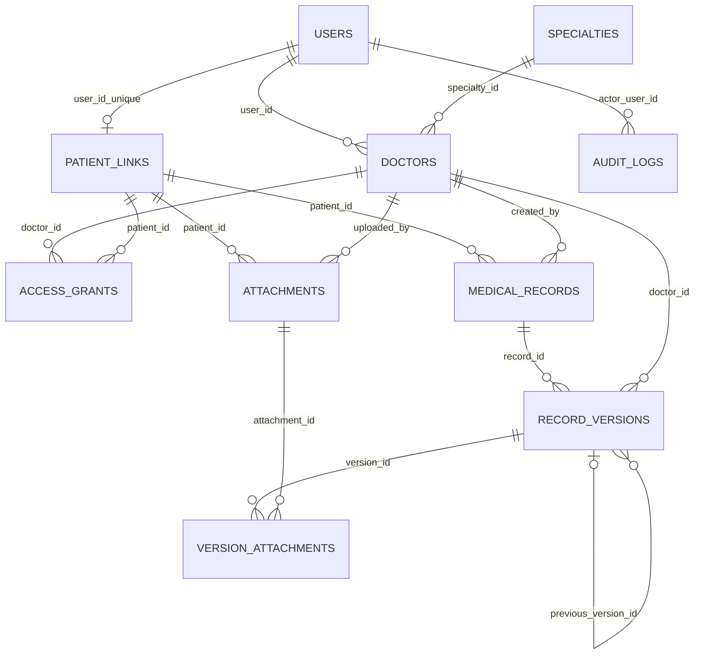

# 15 — Database, toàn bộ Entity và Repository

[← Mục lục](00_INDEX.md)

> Căn cứ: source đang có ngày 17/11/2026. Đây là phân tích tĩnh, không chạy API/test trong lượt viết tài liệu. Kết quả test ở handoff là bằng chứng lịch sử, không phải kiểm chứng Supabase hiện tại. SQL bên dưới chỉ minh họa tương đương logic, không phải log Hibernate.

## 1. Phân biệt schema thực tế và schema đề xuất

public.users/doctors/specialties là các bảng đã được bối cảnh người dùng xác nhận trong quá trình phát triển.
Source Entity ánh xạ chúng, nhưng lượt viết này không truy vấn Supabase để tái xác minh constraint.
Nhóm doctor_backend.* xuất hiện trong SQL đề xuất và SQL khởi tạo H2 local/test; không tuyên bố đã triển khai chung.
Bảng patient_links là cầu nối tới User, không phải tự ý thay public.patients của teammate.

Đối chiếu [PROPOSED_doctor_backend_v1.sql](../sql/PROPOSED_doctor_backend_v1.sql#L1) với
[local-shared-schema.sql](../../src/main/resources/db/local-shared-schema.sql#L1) và
[local-doctor-schema.sql](../../src/main/resources/db/local-doctor-schema.sql#L1).
Không chạy các file để học; đọc cấu trúc đủ cho flow.

## 2. Sơ đồ quan hệ từ SQL đề xuất và baseline local



Sơ đồ USERS→DOCTORS thể hiện mapping ManyToOne hiện có. SQL local còn đặt UNIQUE doctors.user_id,
nên dữ liệu local thực tế tối đa một Doctor/User. Constraint Supabase phải kiểm tra riêng.
SPECIALTIES relation trong Java chỉ là specialtyId Long, không @ManyToOne; FK tồn tại ở SQL.
currentVersion không phải FK đến record_versions.id, mà là số phiên bản trong cùng record.

## 3. Tất cả Entity và trường

Danh sách được lấy từ khai báo field source, gồm chín Entity. Tên snake_case dựa naming strategy Boot hiện dùng;
cột có name cụ thể trong @Column/@JoinColumn cũng phải được xem tại source.

### AccessGrant → doctor_backend.access_grants

[AccessGrant.java](../../src/main/java/com/blockchaincb/demo/entity/AccessGrant.java#L1)

| Field Java | Kiểu | Cột theo naming strategy / mapping |
|---|---|---|
| id | `Long` | id |
| patientId | `Long` | patient_id |
| doctorId | `Long` | doctor_id |
| canRead | `boolean` | can_read |
| canCreate | `boolean` | can_create |
| canUpdate | `boolean` | can_update |
| validFrom | `Instant` | valid_from |
| expiresAt | `Instant` | expires_at |
| revokedAt | `Instant` | revoked_at |

### Attachment → doctor_backend.attachments

[Attachment.java](../../src/main/java/com/blockchaincb/demo/entity/Attachment.java#L1)

| Field Java | Kiểu | Cột theo naming strategy / mapping |
|---|---|---|
| id | `Long` | id |
| patientId | `Long` | patient_id |
| uploadedBy | `Long` | uploaded_by |
| storageKey | `String` | storage_key |
| mediaType | `String` | media_type |
| sizeBytes | `long` | size_bytes |
| sha256 | `String` | sha256 |
| createdAt | `Instant` | created_at |

### AuditLog → doctor_backend.audit_logs

[AuditLog.java](../../src/main/java/com/blockchaincb/demo/entity/AuditLog.java#L1)

| Field Java | Kiểu | Cột theo naming strategy / mapping |
|---|---|---|
| id | `Long` | id |
| actorUserId | `Long` | actor_user_id |
| action | `String` | action |
| resource | `String` | resource |
| outcome | `String` | outcome |
| occurredAt | `Instant` | occurred_at |

### Doctor → public (schema mặc định).doctors

[Doctor.java](../../src/main/java/com/blockchaincb/demo/entity/Doctor.java#L1)

| Field Java | Kiểu | Cột theo naming strategy / mapping |
|---|---|---|
| id | `Long` | id |
| user | `User` | user_id (@JoinColumn) |
| specialtyId | `Long` | specialty_id |
| fullName | `String` | full_name |
| email | `String` | email |
| password | `String` | password |
| licenseNumber | `String` | license_number |
| hospital | `String` | hospital |
| status | `String` | status |
| approvalStatus | `String` | approval_status |
| licenseNo | `String` | license_no |

### MedicalRecord → doctor_backend.medical_records

[MedicalRecord.java](../../src/main/java/com/blockchaincb/demo/entity/MedicalRecord.java#L1)

| Field Java | Kiểu | Cột theo naming strategy / mapping |
|---|---|---|
| id | `Long` | id |
| patientId | `Long` | patient_id |
| createdBy | `Long` | created_by |
| createdAt | `Instant` | created_at |
| updatedAt | `Instant` | updated_at |
| currentVersion | `int` | current_version |
| lockVersion | `Long` | lock_version |

### Patient → doctor_backend.patient_links

[Patient.java](../../src/main/java/com/blockchaincb/demo/entity/Patient.java#L1)

| Field Java | Kiểu | Cột theo naming strategy / mapping |
|---|---|---|
| id | `Long` | id |
| userId | `Long` | user_id |

### RecordVersion → doctor_backend.record_versions

[RecordVersion.java](../../src/main/java/com/blockchaincb/demo/entity/RecordVersion.java#L1)

| Field Java | Kiểu | Cột theo naming strategy / mapping |
|---|---|---|
| id | `Long` | id |
| recordId | `Long` | record_id |
| versionNumber | `int` | version_number |
| doctorId | `Long` | doctor_id |
| previousVersionId | `Long` | previous_version_id |
| previousHash | `String` | previous_hash |
| createdAt | `Instant` | created_at |
| examDate | `LocalDate` | exam_date |
| diagnosis | `String` | diagnosis |
| prescription | `String` | prescription |
| testResults | `String` | test_results |
| notes | `String` | notes |
| canonicalContent | `String` | canonical_content |
| contentHash | `String` | content_hash |
| canonicalSchema | `String` | canonical_schema |
| blockchainStatus | `String` | blockchain_status |
| blockchainTransactionHash | `String` | blockchain_transaction_hash |
| blockchainRecordId | `String` | blockchain_record_id |
| attachmentIds | `List<Long>` | version_attachments.attachment_id (collection riêng) |

### Specialty → public (schema mặc định).specialties

[Specialty.java](../../src/main/java/com/blockchaincb/demo/entity/Specialty.java#L1)

| Field Java | Kiểu | Cột theo naming strategy / mapping |
|---|---|---|
| id | `Long` | id |
| code | `String` | code |
| name | `String` | name |

### User → public (schema mặc định).users

[User.java](../../src/main/java/com/blockchaincb/demo/entity/User.java#L1)

| Field Java | Kiểu | Cột theo naming strategy / mapping |
|---|---|---|
| id | `Long` | id |
| email | `String` | email |
| passwordHash | `String` | password_hash |
| fullName | `String` | full_name |
| role | `String` | role |
| walletAddress | `String` | wallet_address |
| enabled | `boolean` | enabled |
| createdAt | `LocalDateTime` | created_at |


## 4. Annotation và cách dữ liệu đi vào bảng

- @Entity đánh dấu class do JPA quản lý; @Table chọn tên và schema.
- @Id chỉ PK. @GeneratedValue(IDENTITY) để DB cấp ID; Specialty là ngoại lệ dùng ID đã có, không có @GeneratedValue.
- @Column(nullable=false/length/unique) khai báo mapping. ddl-auto=validate không tự tạo constraint UNIQUE còn thiếu.
- @Column(updatable=false) bỏ cột khỏi UPDATE Hibernate; không cấm mọi SQL khác hoặc xóa hàng.
- User.createdAt có insertable=false/updatable=false: DB default tạo timestamp, Java không gửi lúc INSERT.
- Doctor.user thực sự là @ManyToOne(fetch=LAZY), @JoinColumn(user_id,nullable=false); không có @OneToOne ở đây.
- Doctor.specialtyId, Patient.userId, các record/grant/attachment IDs phần lớn chỉ là Long.
  Scalar ID không tự tạo object graph và không tự tải đối tượng liên quan.
- RecordVersion có @Immutable; service tạo object mới cho mỗi snapshot. Không có API xóa/sửa snapshot cũ.
- RecordVersion.attachmentIds là @ElementCollection List<Long> với @CollectionTable(version_attachments),
  @OrderColumn(position), @Column(attachment_id). Đó không phải @ManyToMany List<Attachment>.
- MedicalRecord.lockVersion có @Version để Hibernate kiểm tra cạnh tranh UPDATE.

[Doctor.java](../../src/main/java/com/blockchaincb/demo/entity/Doctor.java#L13) — trích nguyên văn:

```java
  @ManyToOne(fetch = FetchType.LAZY)
  @JoinColumn(name = "user_id", nullable = false)
  private User user;
```

Fetch LAZY nghĩa liên kết có thể chỉ là proxy khi query ban đầu. DoctorRepository.findByUserId dùng EntityGraph
để cần User thì tải ngay. open-in-view=false không giữ persistence context mở đến tận serialize view;
dịch vụ nên map DTO trong transaction. Nếu tự chạm quan hệ lazy sau khi detached có thể gặp LazyInitializationException.

## 5. Toàn bộ chín Repository

Mọi interface dưới đây extends JpaRepository<Entity,Long>; Spring Data cấp implementation lúc runtime.
Không cần viết class triển khai SQL cho save/findById. Generic đầu là Entity, generic sau là PK type.

| Repository | Method/thực thi quan trọng |
|---|---|
| [UserRepository.java](../../src/main/java/com/blockchaincb/demo/repository/UserRepository.java#L1) | findByEmail → Optional<User>; existsByEmail. Auth dùng bảng users, không còn xác thực qua Doctor.password. |
| [DoctorRepository.java](../../src/main/java/com/blockchaincb/demo/repository/DoctorRepository.java#L1) | findByEmail/existsByEmail còn khai báo nhưng không là đường login hiện tại; findByUserId có EntityGraph user. |
| [SpecialtyRepository.java](../../src/main/java/com/blockchaincb/demo/repository/SpecialtyRepository.java#L1) | Không query riêng; register dùng existsById kế thừa. |
| [PatientRepository.java](../../src/main/java/com/blockchaincb/demo/repository/PatientRepository.java#L1) | visible: join User, role PATIENT, tên không phân biệt hoa/thường, EXISTS active READ, order by p.id. |
| [AccessGrantRepository.java](../../src/main/java/com/blockchaincb/demo/repository/AccessGrantRepository.java#L1) | activeLocked: patient/doctor/revoked/time; PESSIMISTIC_READ. Quyền hành động được service anyMatch. |
| [MedicalRecordRepository.java](../../src/main/java/com/blockchaincb/demo/repository/MedicalRecordRepository.java#L1) | forPatient lọc patient và id desc; history thêm creator + active READ + patient filter optional. |
| [RecordVersionRepository.java](../../src/main/java/com/blockchaincb/demo/repository/RecordVersionRepository.java#L1) | findByRecordIdAndVersionNumber Optional; findByRecordIdOrderByVersionNumberDesc trả Page. |
| [AttachmentRepository.java](../../src/main/java/com/blockchaincb/demo/repository/AttachmentRepository.java#L1) | Không query riêng; service dùng saveAndFlush/findById. |
| [AuditLogRepository.java](../../src/main/java/com/blockchaincb/demo/repository/AuditLogRepository.java#L1) | Không query riêng; AuditService dùng saveAndFlush. |

Method kế thừa dùng trong project:

| Method | Tác dụng | Điểm dễ nhầm |
|---|---|---|
| findById | Optional theo PK | Không tự kiểm consent |
| existsById | Kiểm tra tồn tại PK | Không thay validation business |
| save | Đưa Entity mới/hiện có vào persistence | Không đồng nghĩa commit ngay |
| saveAndFlush | save rồi phát SQL đang chờ | Transaction vẫn có thể rollback |
| flush | Đồng bộ persistence context xuống DB | Không tự tạo phiên bản nghiệp vụ |

Query derived findByUserId đi theo property Doctor.user.id, không đòi có field userId riêng trong Doctor.
@Query trong repositories là JPQL theo Entity/property, không phải SQL theo table/column.
@Param gắn tham số an toàn thay vì nối chuỗi input vào query.
Pageable/ Page cung cấp nội dung một trang và tổng số để React phân trang.

## 6. Khóa ngoại và constraint

SQL đề xuất có FK cho patient_links.user_id; grant doctor/patient; root patient/creator;
version record/author/previous; attachment patient/uploader; version_attachments hai FK; audit actorUser.
Vì nhiều trường Java là Long scalar, không suy ra FK từ field mà phải đọc SQL.

Các UNIQUE/CHECK quan trọng:

- public.users.email và local doctors.user_id; cần đối chiếu constraint thật ở shared DB.
- patient_links.user_id UNIQUE.
- record_versions(record_id,version_number) UNIQUE.
- version_attachments(version_id,position) PK và (version_id,attachment_id) UNIQUE.
- validFrom/expiresAt và quyền CREATE/UPDATE yêu cầu READ theo CHECK trong SQL đề xuất.
- versionNumber>0; v1 không có previous, v>1 phải có previous ID/hash.
- blockchain_status chỉ được NOT_SUBMITTED ở giai đoạn này.

FK previous_version_id chỉ bảo đảm ID tồn tại; không tự bảo đảm version trước thuộc cùng record
hoặc đúng số n-1. Service.append đảm bảo logic đó, hash endpoint kiểm lại liên kết liền trước.
Những constraint SQL mới chưa được coi là hiện diện trên Supabase chỉ vì có file đề xuất.

## 7. Transaction, dirty checking và lock

AuthService.register: hai INSERT account trong một transaction.
DoctorService.update: sửa managed User/Doctor rồi Hibernate dirty checking, không gọi save.
MedicalRecordService: @Transactional ở class, cả các method đọc hiện vẫn dùng cấu hình này.
DoctorIdentityService.load/approved và PatientService.list dùng readOnly=true.
DatabasePatientAccessPolicy.require dùng REQUIRED mặc định để giữ khóa grant trong transaction caller.
AuditService.record dùng REQUIRES_NEW, luôn là đơn vị commit riêng.

Self-invocation: trong cùng bean, gọi this.method không đi qua Spring proxy mới.
approved gọi load nội bộ nhưng approved cũng có transaction; trong MedicalRecordService các helper private
append/canonical/allowed chạy trong transaction public bên ngoài, không tự có transaction riêng.

Optimistic locking root phát SQL ý tưởng:
```sql
-- Minh họa logic, không phải câu SQL đã capture:
UPDATE doctor_backend.medical_records
SET current_version = :next_version, lock_version = :new_lock
WHERE id = :record_id AND lock_version = :old_lock;
```
Nếu không update được do lock cũ, Hibernate báo conflict. Pessimistic lock grant dùng query khóa đọc;
đừng nhầm nó là cùng cơ chế @Version.

## 8. Lưu ý hoặc rủi ro

Annotation validate không chứng minh mọi FK/UNIQUE/CHECK ở DB thật khớp thiết kế.
Default schema connection có thể ảnh hưởng các Entity không ghi schema public tường minh.
Không có @OneToMany versions trong root; service truy repository riêng.
@Immutable/updatable=false không chống SQL của admin DB. Content và hash có cùng nguồn nên cần anchor ngoài DB sau này.
Rủi ro bắt RuntimeException từ require trong transaction upload được phân tích ở flow12; không tự sửa tại đây.

## 9. Tự kiểm tra

1. Tại sao Patient.userId là scalar vẫn có FK trong SQL?
2. Version number của URL khác ID record_versions như thế nào?
3. unique=true có tạo constraint khi ddl-auto=validate không?
4. Vì sao Profile sửa mà không cần save?
5. Vì sao flush xong vẫn rollback được?
6. Query nào dùng EntityGraph và query nào dùng PESSIMISTIC_READ?
