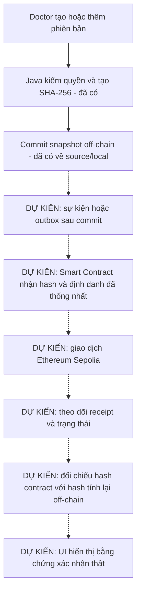

# 16 — Chuẩn bị tích hợp Blockchain: phần đã có và phần chưa có

[← Mục lục](00_INDEX.md)

> Căn cứ: source đang có ngày 17/11/2026. Đây là phân tích tĩnh, không chạy API/test trong lượt viết tài liệu. Kết quả test ở handoff là bằng chứng lịch sử, không phải kiểm chứng Supabase hiện tại. SQL bên dưới chỉ minh họa tương đương logic, không phải log Hibernate.

## 1. Ranh giới của source hiện tại

Java hiện chỉ lưu bệnh án off-chain, snapshot phiên bản, SHA-256 và metadata dành cho tương lai.
React chỉ hiển thị hash/NOT_SUBMITTED. Không có Solidity, Hardhat, Web3j, MetaMask connection,
RPC Sepolia, ví ký giao dịch, receipt confirmation hay API đối chiếu contract đã triển khai.
Mọi phần on-chain dưới đây đều là thiết kế dự kiến; tài liệu không chạy giao dịch hoặc sửa code.

## 2. Những nền tảng đã có

| Nền tảng | Source | Vì sao cần trước Blockchain |
|---|---|---|
| Danh tính và consent | [DoctorIdentityService.java](../../src/main/java/com/blockchaincb/demo/security/DoctorIdentityService.java#L1) và [PatientAccessPolicy.java](../../src/main/java/com/blockchaincb/demo/service/PatientAccessPolicy.java#L1) | Kiểm ai được tạo/đọc/cập nhật trước xử lý dữ liệu |
| Root hồ sơ | [MedicalRecord.java](../../src/main/java/com/blockchaincb/demo/entity/MedicalRecord.java#L1) | Một record có nhiều version |
| Snapshot | [RecordVersion.java](../../src/main/java/com/blockchaincb/demo/entity/RecordVersion.java#L1) | Giữ tác giả, thời gian, nội dung, previous link |
| Ghi version | [MedicalRecordService.java](../../src/main/java/com/blockchaincb/demo/service/MedicalRecordService.java#L91) | Một đường tạo snapshot/hash thống nhất |
| Canonical và digest | [HashService.java](../../src/main/java/com/blockchaincb/demo/service/HashService.java#L1) | Giữ đầu vào hash ổn định |
| Kiểm tra off-chain | [MedicalRecordService.java](../../src/main/java/com/blockchaincb/demo/service/MedicalRecordService.java#L195) | Đối chiếu snapshot, cột và liên kết trước |
| UI bằng chứng | [App.jsx](../../../frontend/src/App.jsx#L89) | Hiển thị hash, ba boolean và trạng thái thật |
| Schema proposal | [PROPOSED_doctor_backend_v1.sql](../sql/PROPOSED_doctor_backend_v1.sql#L1) | Metadata và giới hạn trạng thái, chưa tự áp dụng |

RecordVersion chứa recordId,versionNumber,doctorId,createdAt; previousVersionId/previousHash;
examDate,diagnosis,prescription,testResults,notes; attachmentIds; canonicalContent/contentHash/canonicalSchema;
blockchainStatus,blockchainTransactionHash,blockchainRecordId.

Các trường khám không được tự động đưa lên Ethereum chỉ vì ở cùng Entity với transaction metadata.

## 3. Chuỗi Java tạo hash thật đang chạy

1. CREATE/UPDATE kiểm tra approved và grant.
2. Tạo root hoặc tăng currentVersion (có optimistic lock).
3. append tạo snapshot, normalize text bằng Unicode NFC và newline LF.
4. canonical(r,v) xếp schema, ID record/patient/version/doctor, thời gian, previous link, ngày, text và metadata tệp.
5. HashService.canonical tạo chuỗi mỗi field là byteLength:value, theo UTF-8, không hash JSON tùy key order.
6. sha256 cho32 byte, chuyển hex64 chữ thường.
7. canonicalContent và contentHash được lưu cùng version trong transaction DB.
8. NOT_SUBMITTED được gán; hai trường transaction/record ID on-chain còn null.

[MedicalRecordService.java](../../src/main/java/com/blockchaincb/demo/service/MedicalRecordService.java#L113) — trích nguyên văn:

```java
    v.setCanonicalSchema(HashService.SCHEMA);
    v.setBlockchainStatus("NOT_SUBMITTED");
    String canonical = canonical(r, v);
    v.setCanonicalContent(canonical);
    v.setContentHash(hash.sha256(canonical));
    return versions.saveAndFlush(v);
```

Không có lời gọi mạng nằm giữa các dòng này. Không có chứng cứ rằng Smart Contract đã nhận hash.

Ví dụ canonical đơn giản là canonical("é","x") = "2:é1:x".
Hash bệnh án thật gồm nhiều trường nêu trên; không dùng SHA256("diagnosis") rồi nói giống hash hiện tại.
Nếu contract chọn bytes32, việc chuyển hex64 Java sang32 byte phải giữ đúng bytes và quy ước;
đó là hợp đồng tích hợp dự kiến cần nhóm xác nhận, không phải hàm đã triển khai.

## 4. NOT_SUBMITTED và các cột dự phòng

NOT_SUBMITTED = chưa gửi bằng chứng lên blockchain. Nó không có nghĩa giao dịch đang pending,
đã thất bại, đã được mine hoặc dữ liệu đã xác minh bởi Ethereum.

SQL CHECK hiện chỉ cho blockchain_status='NOT_SUBMITTED'. Các cột blockchain_transaction_hash/
blockchain_record_id được đề xuất nhưng chưa có quy trình cập nhật receipt.
RecordVersion @Immutable và các cột updatable=false còn hạn chế cập nhật ORM.
Vì vậy không thể chỉ gắn một Web3j call và set field rồi mặc định persistence sẽ lưu.
Nhóm cần thiết kế rõ bảng receipt/trạng thái riêng, hoặc migration và mapping tương ứng có review.

## 5. Tại sao cần bằng chứng độc lập?

Endpoint hash kiểm:
- digest canonical snapshot đã lưu có bằng contentHash không;
- digest tái tạo từ cột hiện tại có bằng contentHash không;
- previous ID/hash có nối đúng bản liền trước không.

Nếu ai có quyền sửa cả nội dung, snapshot, hash và liên kết trong cùng DB, họ có thể tạo lại một tập nhất quán.
Ba cờ true không chứng minh dữ liệu chưa từng bị thay đổi bởi người đặc quyền.
Một hash đã neo vào nguồn độc lập và có quy tắc quản trị minh bạch giúp đối chiếu dữ liệu DB
với bằng chứng không chỉ do chính database đó cung cấp.

Hash chỉ bảo vệ toàn vẹn theo cơ chế đối chiếu; không tự xác nhận chẩn đoán y khoa đúng,
không mã hóa nội dung, không cấp consent, không đảm bảo bí mật.

## 6. Sơ đồ dự kiến — CHƯA TRIỂN KHAI



Nét đứt là bước chưa có. Không suy diễn các hộp dự kiến là class/method đã tồn tại.

## 7. File/method nào sẽ mở rộng?

### Sau commit phiên bản

create/update gọi append hiện giữ transaction JPA. Điểm mở rộng nên phát sự kiện/outbox chỉ sau
khi commit thành công, mang version ID và digest đủ dùng. Không nhét RPC chậm vào transaction đang giữ
grant lock/root lock. Nếu DB rollback nhưng giao dịch on-chain đã gửi, sẽ có bằng chứng cho version không tồn tại.

Outbox/queue cần idempotency theo record/version; retry không được tạo nhiều record on-chain ngoài ý định.
Đây là khuyến nghị thiết kế, không có bảng outbox/consumer trong source hiện tại.

### Xác minh

MedicalRecordService.hash là vị trí trả thông tin toàn vẹn đã có quyền READ.
Một adapter xác minh contract tương lai có thể cung cấp digest/receipt đáng tin cho ứng dụng đối chiếu.
Đừng bỏ allowed(...) khi bổ sung endpoint public về hash: hash/ID cũng có thể tiết lộ quan hệ nhạy cảm.
HashService không nên phụ thuộc vào client Web3 hoặc private key để canonical vẫn test độc lập.

### Consent

PatientAccessPolicy là interface thay đổi nguồn quyền được tách sẵn.
Hiện chỉ DatabasePatientAccessPolicy thực thi. Nếu sau này consent nằm cả off-chain/on-chain,
cần quy tắc hết hạn/thu hồi và độ trễ xác nhận; không đổi thành đọc claim JWT cũ.
Danh sách PatientRepository.visible cũng dùng grant DB, nên không chỉ thay require mà quên query danh sách.

### React và ví

RecordDetail có future-slot chỉ là nhãn; thay bằng luồng thật khi có API và trạng thái được nhóm thống nhất.
Profile.walletAddress chỉ read-only; chưa có endpoint liên kết/đổi ví.
Luồng dự kiến là challenge nonce một lần, gắn User/domain/expiry, chữ ký ví và consume nonce nguyên tử.
Không tin địa chỉ Frontend tự gửi, không đưa private key vào React hay Java source.

## 8. Dữ liệu không được ghi on-chain

Không ghi password/password hash, JWT/secret, private key/mnemonic, họ tên/email hoặc mã định danh bệnh nhân
có thể nhận diện trực tiếp, chẩn đoán/đơn thuốc/kết quả xét nghiệm/ghi chú, bytes PDF/ảnh hoặc URL tệp truy cập công khai.
Cả metadata nhỏ như ID, ví và timestamp cũng cần đánh giá nguy cơ liên kết danh tính trước khi công khai.

Hash/schema/version identifier cần tối thiểu hóa và có thiết kế thống nhất với Patient/Admin.
Không coi hash là phép ẩn danh tự động; dữ liệu đoán được vẫn có thể bị thử đối chiếu.

## 9. Câu hỏi kiểm tra trước khi viết Solidity

1. Java hash những field nào theo thứ tự nào, có file bytes hay chỉ metadata digest?
2. Version mới nối H1/H2 như thế nào; ID on-chain có cần lộ patient ID không?
3. DB commit rồi RPC lỗi thì trạng thái nào được giữ và retry theo khóa gì?
4. Transaction đã submit nhưng chưa confirmed phải hiển thị thế nào?
5. Bệnh nhân thu hồi READ thì API xem hash có tiếp tục được phép không?
6. @Immutable/updatable=false ảnh hưởng cập nhật transaction metadata ra sao?

Học xong flow09,10,11 rồi mới dùng tài liệu này để cùng nhóm thiết kế hợp đồng on-chain.
